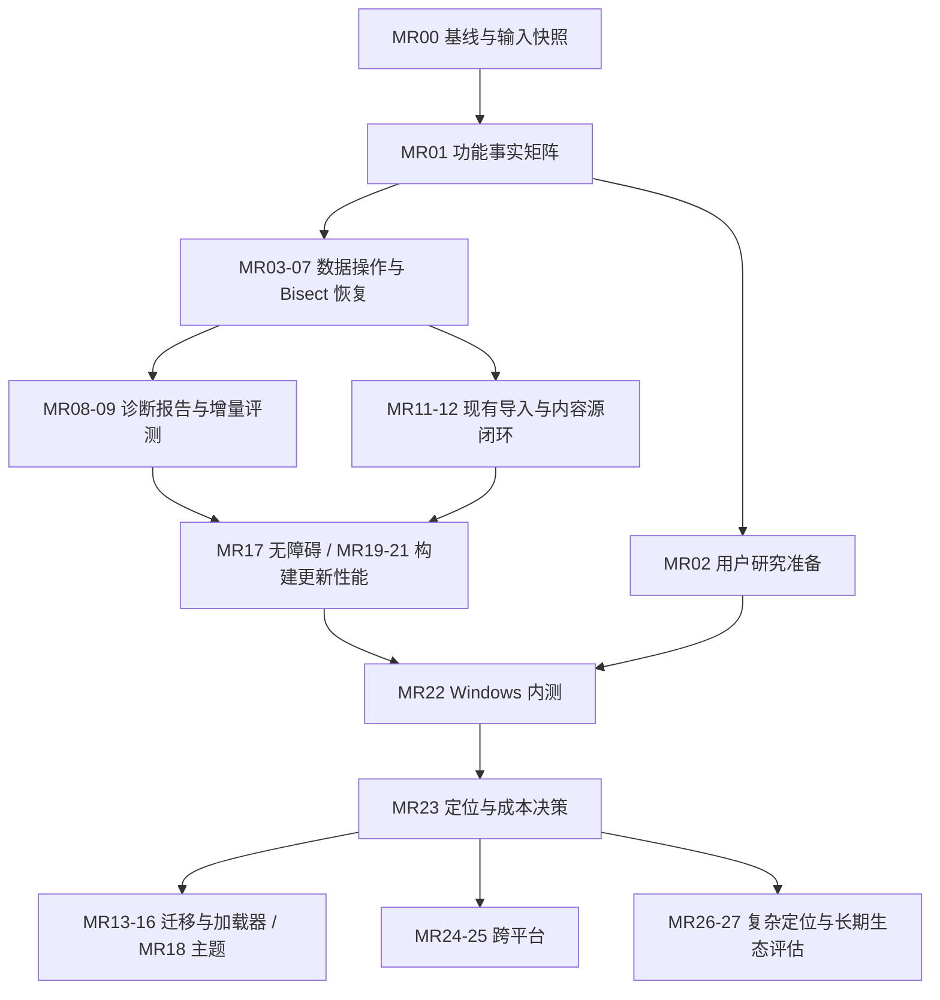

# 松光启动器：市场调研驱动的完整任务流程（2026-10-02）

> **状态：规划完成；没有实施、阶段放行或发布授权。** 本文供产品决策、分批执行和独立验收使用。执行者逐任务推进；每个已授权任务包完成后停在“具备独立复验条件，等待 Codex 独立验收”。

**目标（Goal）：** 把松光建设成面向 Windows Minecraft 玩家、迁移方便、数据可恢复、故障解释可信的启动器，并用真实用户证据决定加载器、跨平台和长期生态投入。

**架构（Architecture）：** 保留 Avalonia 桌面宿主 + WebView2 + HTML/CSS/JavaScript 前端 + C# `LocalApiService` 的现有分工。业务和文件操作在服务端；前端负责呈现、确认、取消和状态反馈；复用现有下载、安装、凭据、存档和诊断服务。新增职责可拆成小服务，不开展全仓库重构。

**技术栈（Tech Stack）：** .NET 10、Avalonia 12、Windows WebView2、原生 JavaScript、xUnit、Node 内置测试、GitHub Actions。`D:\松光启动器\global.json` 本轮读取为 SDK `10.0.301`，执行时以经过核对的实际文件为准。

**需求来源（Spec）：** `D:\市场调研\调研净结论汇总-2026-10-02.md` 为调研决策主入口；使用本文第 2 节的一手代码核对修正其残留错误。完整来源和文件指纹见附录 A。

**执行分工：** Codex 负责目标、优先级、接口与范围决策、关键风险复验；用户明确授权后，MiniMax Code 可承担指定任务包的实现、自检、构建、证据整理和范围内修复。用户的项目协作规范优先于通用规划技能中的提交或子代理建议；本文不要求自动提交，不依赖未安装的技能。

## 1. 使用范围与基线

### 1.1 本轮实际做了什么

- 读取指定项目协作规范、市场调研主报告及松光相关复核材料。
- 检查当前 worktree 与调研所指 `D:\松光启动器` 的 Git 状态、文档、相关源码和既有阶段报告。
- 对加载器安装入口、`.mrpack` 格式和 PCL 仓库许可入口补做官方材料核对。
- 创建本文及独立执行提示词；没有修改业务代码、配置、调研原件，没有运行产品测试或启动应用。

### 1.2 两个目录不能混作同一执行基线

| 对象 | 本轮读取事实 | 使用规则 |
| --- | --- | --- |
| 文档交付目录 | `C:\Users\Administrator\.codex\worktrees\ed41\松光启动器` | 本轮只在其 `docs/` 新增文档 |
| 当前 worktree | `HEAD=f145d14eb26b0b7459a28491e764ac8c573085d3`，分支名为空，属于 detached HEAD；任务开始时 `git status --short -uall` 无输出 | 是提交态历史基线；不能据此认为后续工作区功能均已纳入 |
| 调研引用的主工作区 | `D:\松光启动器`，`main`，同一 HEAD；本轮 `git status --porcelain=v1 -uall` 为 35 个修改项、1251 个未跟踪文件，共 1286 行 | 作为本规划的后续实现事实来源；这些是既有用户资产，不是本轮成果 |
| 既有报告计数 | 首轮“252 项”、打包报告“33 M + 218 未跟踪项”和 `-uall` 逐文件计数口径不同，时间也不同 | 执行前重算；禁止直接比较这些数字得出工作量或丢失文件结论 |

**推荐执行来源：** 后续新任务以 `D:\松光启动器` 的经过审查的工作区内容建立显式输入快照，保留生产源码、测试和必要夹具，排除用户配置、密钥和原始证据。可在隔离快照里执行。当前 ed41 目录只持有本文和交接材料，不自动复制主工作区全部内容，不切换、重置或覆盖任何现有目录。

**MR00 必须输出 `execution-root.json`：** `sourceRoot`、`executionRoot`、HEAD、分支/ detached 状态、输入清单 SHA256、关键源文件 SHA256、SDK/Node 版本、采集时间。后续每条命令先显式核对 `executionRoot`。只有 HEAD 一样，不足以证明两个目录一样。

### 1.3 授权与保护约束

1. 当前授权是阅读调研与规划，本文的步骤均为后续建议，不表示已经执行。
2. 不 `reset/restore/checkout/clean/stash`，不覆盖未提交文件，不批量删除，不 `git add -A`。
3. 提交、推送、PR、合并、发布、部署、标签和外部消息另需相应授权；阶段验收通过也不自动获得这些授权。
4. `D:\市场调研`、既有证据目录、真实 `%APPDATA%\MCMiniLauncher`、凭据、真实游戏目录默认只读。测试使用本任务新建的合成数据和隔离目录。
5. 任何出网诊断测试默认使用合成、脱敏输入。需要真实模型调用时，核实提供商、费用额度和数据外发授权；不能偷偷使用用户配置中的 Key。
6. 对失败形成有意义的 RED；保留原输出、退出码和错误。已有正确行为使用基线回归，不为文档、样式微调编造 RED。
7. 原始日志留本机；可分享的证据索引只列脱敏摘要、命令、哈希、时间、状态和必要链接。
8. 新业务文件、新测试必须进入审查后的源码输入清单；不因为它们未跟踪就遗漏，也不把整个 `docs/` 纳入可分发包。

## 2. 从调研到任务：必须修正的判断

### 2.1 调研结论的采纳规则

后续勘误优先于首轮；本轮源码事实优先于报告中的“已实现/缺失”判断；历史测试报告是历史证据，不能替代本轮复跑。没有用户规模、访谈或安装成功率数据时，产品定位和排期是建议。

| 调研事项 | 本规划采用的结论 | 任务影响 |
| --- | --- | --- |
| AI “无竞品、已领先” | 后续调研已指出成熟规则型分析也是对标对象；本轮没评测真实模型质量 | 用同一案例集比较本地规则、规则 + AI 的正确性和解决率，见 MR09 |
| Bisect “反超 Prism” | 后续调研未找到 Prism 相应断言的足够证据；Quilt Bisect 是应比较的专门工具，维护和覆盖范围需执行时重核 | 保留加载器无关的产品方向；先做恢复安全，再研究依赖/多问题，不写“第一/唯一”，见 MR06、MR07、MR26 |
| Bisect “可靠” | 状态机、API、UI 可在代码中看到；12 个测试方法不等于本轮全部测试通过 | 文件操作成功性、进程中断和真实游戏验证独立设置门槛 |
| Bisect 文件错误 | 本轮看到 `ApplyBisectStep`/`RestoreBisectMods` 捕获异常后只写日志，结束 handler 随后移除会话 | 操作失败不能推进成功状态或丢掉恢复依据，MR06 为 P0 |
| `.mrpack` “缺失” | 本轮看到 `InstancePackService.ImportModrinthPackAsync`、格式探测和 `ModrinthModpackService`；首轮缺失结论不成立 | 改为导入规范、互通、取消与恢复验证；不用重新写一个重复导入器，见 MR11 |
| 实例删除导致存档误删 | 本轮 `HandleDeleteInstanceAsync` 只从 `config.Instances` 移除并保存，未删目录 | 先明确“从列表移除”的语义、关联存档与重新导入；物理删除不在默认实现范围，见 MR03 |
| Mod 删除 | 本轮 `ModService.DeleteMod` 用 `File.Delete` 删除 JAR 和 `.mcmini.json` 侧车文件 | 应增加可恢复隔离区；完整保存元数据，见 MR04、MR05 |
| 加载器“只缺两个” | 当前枚举为 Fabric/Forge/NeoForge/Quilt/OptiFine；对方清单还出现 LiteLoader，不能机械算成 8 减 5 等于 2 | Cleanroom、Legacy Fabric 列候选；LiteLoader 列遗留生态需求评估，不承诺一次补全，见 MR14 |
| 松光采用 Tauri/updater 插件 | 补充报告 1.8/1.10 的松光技术栈描述不符；本轮 csproj 是 Avalonia/.NET，已有 `UpdateService` | 沿用现有更新服务做安全和恢复闭环，不接 Tauri updater，不换栈，见 MR20 |
| CurseForge 内置 Key “违规” | 主净结论已经撤回；源码有官方签发说明；本文不再将内置 Key 定为违规 | 工作重点是第三方分发限制、失效与限流反馈；对授权范围不作额外法律结论，见 MR12 |
| PCL 代码可按 LGPL 复制 | 本轮官方仓库 `LICENCE` 指向有限许可，并附轻度/重度参考指南 | 项目策略为不复制/翻译/移植 PCL 代码，只借鉴用户体验需求；许可审查独立。不能推出“同类功能本身违法” |
| 三平台 CI = 正式跨平台支持 | 当前窗口含 Windows 专用宿主路径；只有编译和历史报告不足以正式宣称多平台 | 先 Windows 可发布候选，再逐平台真实验证，见 MR24、MR25 |
| Quilt 应下线 | 对方产品决策与调研维护时间不是松光用户需求证明 | 保留现有功能，统计兼容性和需求后决定维护等级；不自动移除 |

### 2.2 当前资料能证明到哪一层

- **本轮直接看到：** 现有架构、五种加载器枚举、`.mrpack` 导入方法、Mod 永久删除代码、实例移除语义、Bisect 日志式错误处理、主工作区快照工具及白名单。
- **读取到的历史验收：** `phase3c-1-independent-runtime-acceptance-2026-09-24.md` 记录本地诊断与取消的真实运行；`phase3c-2-independent-acceptance-2026-09-24.md` 记录发送元数据验收，明确精确阶段协议只有设计、3C-3 历史/导出尚未启动。
- **读取到的历史可复现性/打包：** 9 月 28 日候选快照报告区分非 RID 锁定与 RID 发布未锁定；10 月 1 日打包报告记录源码归档与编译。本文没有重跑这些流程，不继承旧测试数量作为当前结果。
- **仍未验证：** 当前整体构建、真实账号和下载、真实 AI 的质量、重启后 Bisect 恢复、完整更新失败恢复、非 Windows 真实运行、用户需求和付费意愿。

## 3. 产品定位、范围与衡量方法

### 3.1 建议的第一目标用户

优先服务 Windows 上已有 Minecraft/整合包使用经验、遇到 Mod 或 Java 故障、希望保留存档并迁移现有实例的中文玩家。次要群体是帮助朋友排错的整合包维护者。该画像是基于调研和现有实现的**待验证假设**，MR02/MR22 用访谈与实测校准。

第一版价值表述建议：**“保留你的实例与存档，更容易定位问题，并能撤销文件操作。”** AI 是可选的解释增强；本地规则、恢复安全和迁移体验是无 Key 用户也能获得的基础能力。

### 3.2 版本边界

| 版本 | 必需交付 | 进入条件 |
| --- | --- | --- |
| V0：可信基线 | 明确执行根、来源、功能事实矩阵、源码白名单、用户研究材料 | 当前规划结束后获得 MR00/MR01 的授权 |
| V1：Windows 内测候选 | 可逆 Mod 操作、Bisect 错误/重启恢复、实例移除语义、诊断报告、本地降级、现有导入验证、基本无障碍、可复现构建、更新恢复 | 核心任务逐包独立验收；内测分发另获授权 |
| V2：需求证明后的增强 | 旧启动器实例迁移、Legacy Fabric/Cleanroom、主题；按实际需求选择 | V1 内测记录支持投入，相关任务另获授权 |
| V3：平台与生态 | 一个非 Windows 平台的真实 beta、复杂 Bisect、共享实例/扩展评估 | 完成专项技术与用户决策门槛 |

不把聊天全家桶、移动端、所有 CPU 架构、云同步、插件市场、手柄、运行时模拟预加载或大规模重构列入 V1。

### 3.3 建议指标（不是现有业绩）

| 指标 | 定义与采样 | 建议门槛/用途 |
| --- | --- | --- |
| 数据安全 | 合成样本执行删除、替换、取消、失败、恢复后的路径与 SHA256 对比 | 必需用例中不可恢复的数据损失为 0；任何误删或恢复覆盖阻断放行 |
| 首次成功启动 | 首次安装/迁移后达到游戏主菜单并正常退出的参与者 / 有效尝试者 | 记录原始分子/分母；10 人内测建议至少 8 人独立完成，样本小不外推市场比例 |
| 迁移完成 | 指定来源的实例能导入、正确还原配置和必要文件、启动并退出 | 受支持样本 100%；不支持项目有明确报告，不能静默丢弃 |
| 诊断安全 | 无凭据外泄、无无根据的自动危险动作；规则不可用 AI 才报错的路径 | 凭据外泄/自动危险动作 0；AI 失败仍能读到本地结果 |
| AI 增量价值 | 同一脱敏案例集的规则结果与 AI 增强结果盲评，记录证据定位、正确修复建议、错误确信、成本与延迟 | MR09 冻结案例集后：已知问题正确建议率不下降；未知类案例至少新增 3 个被独立复现的有效建议；未达到则降为实验功能 |
| 操作耗时 | 首次安装、迁移、找出指定单点 Mod 故障的完成时间；报告中位数/范围 | 与同机原流程对照，样本与游戏版本一致；不用 star 或功能数替代 |
| 性能 | 指定机器的冷/热启动、实例列表、100/500 Mod 列表、搜索响应 p50/p95 | MR21 测得基线后冻结预算：核心流程 p95 回退不超过 10%；绝对目标另依据机器确定 |
| 可访问性 | 键盘走完登录/安装/诊断/恢复；焦点可见与回收；125%/150%/200%缩放 | 核心流程无键盘阻断、无不可达确认按钮、无必要信息裁切 |
| 持续使用 | 同一内测群第 7/14 天是否自愿继续使用，及放弃原因 | 用来决定 V2 投入，不把下载数当留存 |
| 成本 | 每个诊断的请求/重试、可测 token/费用、带宽、错误比例；用户自备 Key 与项目支付分开 | 无明确预算不引入项目代付模型；不推断免费 Key 可无限用 |

## 4. 全局依赖与任务总表

任务编号固定，MR 表示本轮市场调研路线，**不替换**历史 Phase 3A/3B/3C 的验收编号。每个 MR 任务引用历史证据，但状态由本次执行重新决定。



图中的汇合表示候选发布门槛；源码与内测材料可在依赖满足后准备。没有授权的节点不启动。

**工期单位为单执行者有效工作日，含实现、自检和一次独立复验准备；不含用户等待、模型/网络不可用和多轮返工。它是粗估区间，不是日期承诺。**

| ID | 任务 | 优先级 | 前置 | 粗估 |
| --- | --- | --- | --- | --- |
| MR00 | 执行基线与显式源码输入 | P0 | 执行授权 | 2–3 |
| MR01 | 功能事实矩阵与调研纠偏 | P0 | MR00 | 1–2 |
| MR02 | 用户研究材料与样本计划 | P0 | MR01 | 1–2 |
| MR03 | 实例移除、存档提示与恢复入口 | P0 | MR01 | 1–2 |
| MR04 | Mod 可恢复删除 | P0 | MR01 | 3–5 |
| MR05 | Mod 替换/更新的事务与撤销 | P0 | MR04 | 2–4 |
| MR06 | Bisect 文件操作结果与状态一致性 | P0 | MR01、MR04 | 3–5 |
| MR07 | Bisect 重启恢复、依赖与存档保护 | P0 | MR06 | 3–5 |
| MR08 | 诊断历史、脱敏与报告导出 | P1 | MR01；动作依赖 MR04/MR06 | 3–5 |
| MR09 | AI 对规则引擎的增量评测 | P1 | MR08 | 3–5 |
| MR10 | 服务端诊断进度协议（条件任务） | P2 | MR08、确有进度体验问题 | 2–3 |
| MR11 | `.mrpack` 规范与失败恢复闭环 | P0 | MR01、MR04 | 2–4 |
| MR12 | CurseForge 分发限制与限流闭环 | P1 | MR01、MR11 | 2–3 |
| MR13 | Prism/HMCL/PCL 实例迁移 | P1 | MR11、MR22 用户需求 | 4–6 |
| MR14 | 加载器和 Quilt 投入决策 | P1 | MR02、MR22 | 1–2 |
| MR15 | Legacy Fabric 支持 | P1 条件 | MR14、MR19 | 4–6 |
| MR16 | Cleanroom 支持 | P1 条件 | MR14、MR19 | 5–8 |
| MR17 | 核心流程无障碍与小窗口体验 | P1 | MR03、MR08、MR11 | 3–5 |
| MR18 | Token 统一与用户主题 | P2 | MR17、MR22 用户需求 | 3–5 |
| MR19 | 可复现构建、RID 边界与 CI | P0 | MR00；候选前整合全部新输入 | 2–4 |
| MR20 | Windows 自更新的验证与恢复 | P0 | MR19、MR04 恢复模式 | 3–5 |
| MR21 | 安装启动与性能基线 | P1 | MR19、MR20 | 2–3 |
| MR22 | Windows 内测与改进闭环 | P0 | V1 所有必需任务、分发与联系授权 | 3–5，加 14 天观察 |
| MR23 | 产品定位、渠道与维护成本 | P1 | MR02、MR09、MR12、MR22 | 1–2 |
| MR24 | 非 Windows 宿主和平台可行性 | P2 | MR19、MR23 | 2–3 |
| MR25 | 单平台正式 beta | P2 条件 | MR24 通过且获平台范围授权 | 8–12 / 平台 |
| MR26 | 复杂 Bisect 与冲突可视化评估 | P2 | MR07、MR09、MR22 | 2–3（评估） |
| MR27 | 共享实例、扩展、手柄/移动端决策 | P3 | MR13、MR23 | 1–2（评估） |

## 5. 任务执行通则

### 5.1 统一执行顺序

每个任务都执行以下流程；“确认任务包”由授权信息完成，不能用生成本文代替。

- [ ] 读取 MR00 的执行根、授权任务 ID、输入 SHA 和本任务允许路径；确认没有额外并行写入。
- [ ] 保存该任务开始前 Git 状态、涉及文件哈希和现有差异；若与快照冲突，先核对差异归属。
- [ ] 用合成、隔离样本复现任务指出的具体缺口；记录有意义的 RED 或明确基线已有正确行为。
- [ ] 实现最小闭环：服务层 → API → `api.js` 的 live/mock → 页面 → 中英文 → 文档；只触碰本任务边界。
- [ ] 执行该任务聚焦验证和适当的共同回归；真实 GUI/游戏、文件恢复、取消和并发单独留证。
- [ ] 核对真实配置、主工作区既有资产未被测试改写；检查新增源码输入没有遗漏。
- [ ] 输出任务报告、改动白名单、测试总数/失败数、未验证项和恢复方案。
- [ ] 停在独立验收点。Codex 查实际 diff、原日志并重跑关键路径；用户明确批准后才记为该任务“已放行”。

### 5.2 小任务与边界

一项可独立验收的 API/文件事务是一任务，不按“只加字段”“只写按钮”拆成大量无法单独使用的节点。调查发现新问题时记录；只有与本任务交付直接相关的最小修复才能在授权范围内继续。

## 6. V0：建立可相信的基线

### MR00：执行根、源码输入与证据基线

**目标：** 避免从干净旧 HEAD 执行新功能，或只带已跟踪修改而漏掉未跟踪依赖。

**允许路径：** `scripts/verify-source-snapshot.ps1`、`scripts/source-snapshot-inputs.txt`、新建 `docs/market-execution/MR00/`。现有生产代码只读。当前两份规划文档只读。

**步骤：**

- [ ] 对照两个根目录的 HEAD/Git 状态和关键文件 SHA；辨认未跟踪生产源、测试、夹具、工具、历史证据。
- [ ] 审查已有白名单，核实每一输入的用途；新增任务源码逐项入清单，不把整个目录通配纳入。
- [ ] 核查当前快照工具参数、失败传播与计数假设；旧 161/53/214 等数字如已变化须按当前输入计算，不能为凑数丢文件。
- [ ] 在新隔离目录生成候选快照；记录源目录和执行目录，不带真实配置、凭据、游戏存档和原 `bin/obj`。
- [ ] 执行锁定还原、构建、正式 Node/xUnit 测试；已有正确快照流程不重复造 RED，白名单缺依赖时保存真实失败后最小补齐。
- [ ] 生成 `execution-root.json`、`input-manifest.json` 和 `baseline.md`。分开记“冷构建通过”“全套测试通过”“RID 发布锁定情况”“真实运行未验证”。

**验收：** 输入逐项存在且 SHA 匹配；无未知额外输入；同快照构建与测试成功；任何失败原样记录。RID 未锁定可作为 V0 已知边界，但不能宣称完整锁定发布。

**交付：** 可复验的快照路径和日志索引。**停止：** 仅完成基线；不自动修改其余 MR 任务代码。

### MR01：刷新功能事实矩阵并清除调研错误

**允许路径：** `README.md`、`docs/README.md`、`docs/features.md`、`docs/roadmap.md`、`docs/architecture.md`、`docs/development-guide.md`、新建 `docs/market-execution/MR01/`；代码与市场调研原件只读。

- [ ] 为账号、启动、安装、内容、存档、皮肤、新闻、AI、Bisect、更新、平台分别记录：声明、服务方法、API、UI、测试、真实行为、证据时间与输入版本。
- [ ] 状态使用“代码存在 / 自动验证 / 真实场景验证 / 未验证 / 不支持”，不能用一个绿色勾覆盖所有层级。
- [ ] 明确 `.mrpack` 已有导入、实例删除只移除记录、松光非 Tauri、三平台不等于正式支持、Bisect 失败处理风险。
- [ ] 不沿用“反超 Prism”“唯一 AI”“PCL 无公开仓库”等表述；竞品的未发现功能写“本次材料未证实”。
- [ ] 关联既有 Phase 3C-1/3C-2 与源码可复现性报告，列出当前待复验差异，不重新宣布历史 Gate。
- [ ] 给每个缺口关联本文 MR ID，保持 `roadmap.md` 和 `features.md` 一致。

**验收：** 每个肯定功能有代码/路由/交互证据；真实运行状态有对应日志和版本，缺证据明确标注；文档不残留未勘误的旧断言。仅做文档核对，不需要产品测试来证明文案修改。

### MR02：用户需求研究准备

**允许路径：** 新建 `docs/market-execution/MR02/`；其他代码、配置只读。

- [ ] 准备 8–12 人访谈提纲，覆盖 HMCL/PCL/Prism 用户、整合包维护者、新手，至少每类 2 人；记录实际招募偏差。
- [ ] 问过去一次安装/排错/误删/迁移经历、现在的替代方式、为何不换、愿意保留什么数据、是否愿意外发脱敏日志；避免问“你想要 AI 吗”当需求证据。
- [ ] 设计统一任务：迁移一个合成实例、首次安装进入菜单、恢复一次 Mod 删除、定位预置崩溃；准备计时、卡点和结果表。
- [ ] 准备 7/14 天跟进问卷、放弃原因分类和最小隐私说明；收集默认手工/本地，不接远程遥测。
- [ ] 将招募、联系、外部表单发布作为需要用户授权的后续动作；无样本时只交付材料，用户画像仍标为假设。

**交付/验收：** 提纲、任务脚本、匿名编号规则、原始记录模板、招募计划完整；没有伪造访谈或已联系用户的记录。MR22 负责执行研究。

## 7. V1 优先：数据安全和 Bisect 恢复

### MR03：实例“从列表移除”的准确语义

**既有入口：** `LocalApiService.HandleDeleteInstanceAsync`；实例配置和存档由现有服务维护。

**允许修改：** `LocalApiService.cs` 的实例查询/移除路由、`InstanceService.cs`（确有需要才改）、`ui/js/{api,launcher,i18n}.js`，新增 `InstanceRemovalTests.cs`、`instance-removal.test.cjs` 及本任务文档。`SaveService.cs` 本包只读。

- [ ] 复现有存档实例被移除后目录仍在的既有行为，保存配置与文件 SHA。
- [ ] 将 UI 术语明确成“从列表移除”；确认面板列出目录、存档数量、其他实例是否共享目录、数据仍保留，以及重新添加入口。
- [ ] 用户取消不改配置；正常移除改变选中实例时保持可用；正在运行/Bisect 中的实例拒绝移除或明确要求先结束，不能留下悬空状态。
- [ ] 提供重新添加/恢复列表记录的路径，恢复时不改存档；物理删除不加入本包。
- [ ] 核对两实例共享目录、最后一个实例、默认实例、目录不可读、重复点击和中英文确认。

**RED/GREEN：** 新提示、重新添加和活动状态保护缺失时有针对性失败用例；“不删除目录”作为已有正确回归。**验收：** 移除和取消均不改存档/Mod 字节；恢复可重新访问；不能在 UI 暗示已删除文件。

### MR04：Mod 删除改为可恢复隔离

**允许修改：** `ModService.cs`、新建 `FileRecoveryService.cs`、新建模型 `FileRecoveryRecord.cs`、`LocalApiService.cs` 相关 Mod/恢复路由、`ui/js/{api,launcher,i18n}.js`，本任务测试/文档。`ui/css/figma.css` 仅新增恢复面板样式。

**建议契约（新设计，非现有 API）：** `FileRecoveryRecord` 包含 `operationId`、实例 ID、原相对路径、隔离位置、各文件 SHA256、时间、启用状态和状态。`FileRecoveryService` 暴露 `QuarantineAsync`、`RestoreAsync`、`ListAsync`，返回逐文件结果，不只返回一个成功布尔值。最终具体签名在实现包开头冻结。

- [ ] RED：删除带 `.mcmini.json` 的合成 Mod 后，现实现不能恢复；另测启用/禁用两种文件名。
- [ ] 采用实例外独立、受管理的恢复根和唯一操作 ID；先保存恢复记录，再移动文件；跨卷采用复制 → SHA 校验 → 完成记录 → 移除源的顺序。
- [ ] JAR 与侧车作为同一操作恢复；任一失败不宣称删除成功，保留源或可验证的恢复副本。
- [ ] 新增恢复列表、原位置冲突提示和恢复操作；默认不覆盖同名现有文件。
- [ ] 处理只读/占用、磁盘不足、路径越界、符号链接/重解析点、相同操作重试、进程中断和双击重复提交。
- [ ] 保留策略建议默认 30 天且可配置；V1 不自动物理清理。先提供容量和过期提示，永久清理后续单独授权设计。

**验收：** 至少启用/禁用/侧车/同名冲突/跨卷失败/中断六类情境的原件或恢复件 SHA 可核对；重复恢复幂等；未知文件不被移除；真实 GUI 能删后恢复。独立验收重点是跨卷中断与路径越界。

### MR05：替换与更新的可撤销事务

**允许修改：** `ModService.cs`、`ModContentService.cs` 的安装/更新应用路径、MR04 的恢复服务、相关 Mod API/UI、本任务测试/文档。下载器核心和内容图标模块只读。

- [ ] 找出实际更新/同名安装的调用链，记录旧 JAR、侧车、启用状态和在线版本映射；不只修改 `DeleteMod`。
- [ ] RED：新包下载/校验/写入在不同阶段失败时不能保证旧版本仍可使用的具体用例。
- [ ] 新包到 staging，校验成功后再隔离旧包；记录每个状态，成功才提交新版本及元数据。
- [ ] 失败恢复旧包和元数据；批量更新逐项报告已完成、已恢复、未执行，不把部分完成算全部成功。
- [ ] 禁用 Mod 更新后仍保持禁用；取消在提交前停下，在提交期间走事务恢复；禁止并发替换同一目标。
- [ ] UI 显示版本、变更、失败原因、撤销入口；不能将旧文件永久删除作为默认更新策略。

**验收：** 下载失败、hash 不符、提交中断、侧车失败、占用、重复请求均无旧版本数据损失；撤销恢复 SHA/状态。按真实安装 UI 再走一次更新→撤销。

### MR06：Bisect 操作失败必须阻止错误推进

**允许修改：** `ModBisectService.cs`、`LocalApiService.cs` 的 Bisect handlers/辅助函数、`ModService.cs` 的必要启停结果、`ui/js/{api,launcher,i18n}.js`、`VerifyHost/Program.cs` 相关 smoke、本任务测试/文档。

**复现证据：** `ApplyBisectStep`/`RestoreBisectMods` 当前捕获异常只写日志；`HandleBisectTestAsync` 在完成路径恢复后移除会话。此代码风险须用被占用/冲突/权限错误的合成目录复现，不能只靠静态猜测确认实际发生。

- [ ] RED：四个待禁用文件中一个操作失败，API 不得仍报告该轮已就绪；恢复失败时不能把会话删除为完成。
- [ ] 操作结果分别记录 `applied`、`failed`、`unchanged` 和错误原因；候选状态提交与实际文件状态一致。
- [ ] 一轮部分失败时进入“需要恢复/重试”，不接受用户崩溃反馈继续收窄；恢复完整性失败保留恢复上下文。
- [ ] 为实例提供单写锁/版本令牌，start/test/giveup 和 Mod 手动操作冲突要显式拒绝；同轮重复结果不推进两轮。
- [ ] 完成/放弃仅在恢复核对成功后移除会话；UI 区分定位完成、恢复完成、恢复未完成。
- [ ] 改造真实 API smoke，以故障注入补充现有 8→4→2→1 正常路径，不降低或删除已有测试。

**验收：** 每轮候选、落盘启停、API 状态相互一致；失败时不出现“成功”误报；原已禁用 Mod 不被误启用；同实例并发请求有确定结果。独立复验以真实 API 和文件 SHA 为主。

### MR07：Bisect 重启恢复、依赖与世界安全

**允许修改：** `ModBisectService.cs`、新建 `BisectRecoveryStore.cs`、现有实例/Mod 健康检查接口的最小读取调用、Bisect API/UI、相关测试/文档。存档服务、启动器核心先只读，确需改动时另开精确子包。

- [ ] RED：开始 Bisect 后关闭/终止测试宿主并重启，验证现有内存会话不能提供完整恢复指引。
- [ ] 落盘会话 ID、实例/目录身份、基线文件名和 SHA、原启停状态、已应用轮次、操作事务状态；原子写入并校验记录。
- [ ] 重启检测未完成会话，提供“恢复原状态”“继续上一有效轮”的选择；校验文件变化，有冲突时逐项说明而非覆盖。
- [ ] 恢复仅触碰本会话管理的文件，不启用用户原禁用 Mod，不删除后来加入的文件，不从文件名猜回原状态。
- [ ] 启动前利用依赖元数据检查被禁用集合：缺前置、互相依赖、元数据缺失的轮次标为无效测试，不能当成同一原崩溃。
- [ ] UI 要求在临时测试世界/实例副本运行；V1 不自动进入真实世界，不承诺能通用禁用世界保存。给出可校验的存档备份/副本操作指引。
- [ ] 用合成宿主做进程中断恢复，真实 Minecraft 用测试副本验证；原存档 SHA 前后相同。

**验收：** 中断发生在记录前/移动中/轮次提交后/恢复中各点都能恢复或明确列出冲突；依赖导致的新崩溃不会错误收窄；回滚有磁盘证据。

## 8. 诊断能力：把已有 AI 做成可证明的价值

### MR08：本地诊断历史、脱敏和导出

**依托：** 现有 `AiDiagnoseService.cs`、`DiagnosticSnapshotService.cs`、`AiOperationRegistry.cs`、规则/健康检查，保留 Phase 3C-1 的事实/推断/未知呈现和 Phase 3C-2 服务端发送元数据。

**允许修改：** 上述诊断相关文件、新增 `DiagnosticReportService.cs`/`DiagnosticReport.cs`、`LocalApiService.cs` 的 diagnose/history/export 路由、`ui/js/{api,launcher,i18n}.js`、诊断 CSS、本任务测试/文档。凭据服务只读，新增配置项需单独列明 `AppConfig.cs`/`ConfigStore.cs` 的精确字段。

- [ ] 冻结报告结构：报告 ID、实例标识、软件/游戏/加载器版本、规则证据、AI 解释、fact/inference/unknown、provider/model、真实发送时间、取消/失败状态、操作建议和脱敏说明。
- [ ] 本地历史默认只保存脱敏摘要；原日志正文默认不保存，原文导出需要单独勾选与预览。建议保留最近 50 条摘要/30 天，超额提示用户清理，不静默丢掉待恢复证据。
- [ ] 覆盖账户 token、API key、authorization header、用户名路径、服务器地址等脱敏样本；保持堆栈中必要类名/Mod 名，不能把诊断线索全部删掉。
- [ ] 导出 UTF-8 Markdown + JSON 两种可读格式，校验字段与界面一致；不导出 provider URL、Key 或内部完整 prompt。
- [ ] 取消后旧请求不得写入新实例历史；同一操作只记录一次；AI 超时/限流/无 Key 保留规则结果。
- [ ] AI 给出的动作只通过已注册安全动作映射显示按钮；禁用前确认并使用 MR04/MR06 的恢复机制，未知 shell 命令不能直接执行。

**RED/GREEN：** 历史为空/导出缺失或脱敏漏项各有行为测试；协议采用合成提供商。**验收：** 本地模式零外部请求；报告不含敏感串；真实 WebView2 可查历史和导出；100%准确/用户正确度不是本任务结论。

### MR09：冻结案例集，验证 AI 相对规则的增量

**允许路径：** 新建 `dev/PineglowLauncher.Tests/TestAssets/Diagnostics/` 的合成/授权脱敏案例、`DiagnosticBenchmarkTests.cs`、`scripts/run-diagnostic-benchmark.ps1`、`docs/market-execution/MR09/`。本包不重写规则和 AI 服务；若评测发现产品 bug，另以精确范围开修复包。

- [ ] 准备至少 30 案例：15 已知规则问题、10 规则未知/信息不足、5 混合/误导/日志注入；覆盖 Java、加载器、缺依赖、单 Mod、多问题、网络、内存和非 Mod 故障。
- [ ] 每例写明真实原因、可证据定位、可执行修复、危险操作和应回答未知的条件；建立 20 开发/10 保留评测集，按原因分组防泄漏，避免为某 prompt 特造评测。
- [ ] 同一原始输入走规则、规则 + AI 两组；可用时同条件记录竞品诊断作为观察，不以竞品不同案例输出直接排名。
- [ ] 盲评只对照证据和修复复现；每条建议记正确/部分/错误/信息不足，区分“文本更流畅”与“实际修好了”。
- [ ] 首轮仅合成模型/fake handler 验证评测工具；真实调用须有明确费用和外发授权，固定模型/version/参数/日期，记录每例成本与延迟，至少三次观察非确定性。
- [ ] 用第 3.3 节门槛决策：已知正确率不下降、未知至少 3 个新增可复现有效建议、危险自动操作/凭据外泄 0。达不到则保留实验开关、加强规则和提示，不能发布“AI 优于竞品”宣传。

**交付：** 案例 manifest、输入 SHA、两组逐例结果、评分依据、成本/延迟、反例和产品决策。**验收：** Codex 独立抽查全部危险建议及至少 5 个普通样本，复现修复，不只读执行者总结。

### MR10：真实进度协议（仅在等待体验需要时）

**允许修改：** `AiOperationRegistry.cs`、诊断服务/路由、api/UI/i18n、协议测试/文档；以现有阶段协议设计为只读参考。

- [ ] 先用 MR09 延迟观察判定是否需要轮询；若延迟可接受，维持明确的等待/取消状态并记“无需实现”。
- [ ] 必要时定义 requestId、阶段枚举、单调 sequence、start/end 时间、terminal 状态和安全错误码；只在真实阶段事件发生时推进。
- [ ] 前端切换实例/取消/关闭时停止轮询，忽略过期序列；进程重启后操作不存在返回明确终止状态。
- [ ] 覆盖规则完成、请求构造、发送尝试、响应读取、解析失败、取消；“发送”不能由前端计时器推断。

**验收：** 故障注入时事件和页面一致；不显示虚假的百分比；没有事件时可显示等待。仅协议完成不替代 MR09 质量评测。

## 9. 迁移与内容生态：完善现有能力

### MR11：现有 `.mrpack` 导入的规范、互通与回滚

**允许修改：** `InstancePackService.cs`、`ModrinthModpackService.cs`、`ModpackLifecycleService.cs` 的相关导入路径、必要的本地下载调用接口、导入 API/UI/i18n；新增 `MrpackCompatibilityTests.cs`、`instance-import.test.cjs`、合法/恶意合成 pack 夹具和本任务文档。

- [ ] 建立现有 `.mcm`/CurseForge/Modrinth 格式探测回归；不重复实现导入服务。
- [ ] 按官方规范复核 index、dependencies、文件路径、hash、环境可选/必需/不支持、override 层次；实现风险项对应边界用例。
- [ ] 客户端不安装 server-only 项；可选项先让用户选择；未知依赖/未来格式不静默当 Vanilla 安装。
- [ ] 合成 pack 覆盖 `../`、绝对路径、Windows 盘符/UNC、链接、大小与文件数限制、重复路径、hash 错误、缺文件和下载重定向到私网。
- [ ] 在 staging 中完整安装与校验后提交实例；取消/网络失败不留下“可运行”半成品，不覆盖同名已存在实例。
- [ ] 用获得许可的真实小 pack 验证导入、加载器安装、进入主菜单、正常退出；记录 pack/游戏/Java/Mod 清单 SHA。
- [ ] 将受支持规范、已知不支持项写入功能基线；`.mrpack` 导出是否新做由 MR22 分享需求决定，不把导入等同导出。

**官方来源：** [Modrinth `.mrpack` 规范](https://support.modrinth.com/en/articles/8802351-modrinth-modpack-format-mrpack) 包含路径、hash、环境、下载地址与 overrides 规则；执行时固定阅读版本和抓取日期。

**验收：** 支持样本可启动；非法/未知包有明确错误且隔离目录外零写入；取消/失败可恢复；界面数据和落盘结果一致。

### MR12：CurseForge 分发限制与来源失效

**允许修改：** `ModContentService.cs`、`InstancePackService.cs` 的 CF 路径、内容/导入 API、api/UI/i18n、CF fake HTTP 测试/文档。内置 Key、真实用户凭据和真实配额只读。

- [ ] 明确分发不可用/无 download URL、401/403、429、5xx、超时和坏响应的状态映射；不把任何失败都写成“网络错误”。
- [ ] 受限制文件给出官方项目页、文件名/版本、合法手动取得和校验步骤；不绕过作者的第三方分发限制。
- [ ] 导入缺失项分开记录必需/可选；必需缺失不能标记整合包已成功安装。
- [ ] 限流尊重 Retry-After 和有界重试；取消后不继续请求；日志无 Key，不因失败自动切换到未授权来源。
- [ ] 内置 Key 失效时提示用户设置个人 Key 或使用其他合法内容源，不删除官方签发配置、不宣称 Key 模式违规。

**验收：** fake HTTP 逐状态验证；真实公开请求若做只取非敏感小样，先确认配额和授权。无绕过分发限制行为；报告逐文件可解释、可恢复。

### MR13：旧启动器实例迁移

**范围：** 先做 MR22 中需求最多的一种来源，再决定扩展；推荐先 Prism/MultiMC 的实际实例 ZIP/目录，然后 HMCL/PCL 目录读取。`.prisminstance` 只是报告中的称呼，不能仅按扩展名认定通用规范。

**允许修改：** 新建 `InstanceMigrationService.cs`/`InstanceMigrationPlan.cs`、`InstancePackService.cs` 的格式入口、导入 API/UI/i18n、相关夹具/测试/文档。源启动器代码与源实例只读。

- [ ] 取一个合法真实导出样本与一个目录样本，核对 `mmc-pack.json`/组件配置等真实结构；固定版本和样本 SHA，识别自定义 patches。
- [ ] 先给迁移预览：游戏/加载器/Java、Mod 数、存档和设置、可迁移/需重下/不支持项；不复制账户 token、缓存凭据或绝对路径。
- [ ] 只读取源，复制到新目标；同名避让、不覆盖，不把“从源删除”当迁移步骤。
- [ ] 未识别 loader/patch 返回具体不支持项；能确认的内容按现有安装器重建，不能只把字段换名。
- [ ] 对比 Mod/hash、存档、配置和启动行为；再测试来源目录只读、超大包、取消、磁盘不足、缺文件及路径穿越。

**验收：** 原实例 SHA/布局不变；已承诺样本能启动；所有丢失/不支持项在提交前可见。对 PCL 只解释用户持有的数据，不拷贝其源码。

## 10. 按需求补加载器，保持既有兼容

### MR14：加载器需求与 Quilt 维护等级

**允许路径：** `docs/market-execution/MR14/`、`docs/roadmap.md`/`features.md` 的计划字段；代码只读。

- [ ] 结合 MR22 实测失败和访谈，记录各版本/整合包实际要求；分开 Cleanroom、Legacy Fabric、LiteLoader 和 Quilt。
- [ ] 对每个候选核实官方 metadata、installer、Java 需求、支持版本、可用内容源、维护时间和安装/启动难度。
- [ ] Cleanroom 本轮官方 README/安装指南描述 MC 1.12.2 和 Java 25 的当前路径；不要照搬普通 Forge 的 Java 8 规则。绑定具体发布版本重新验证，不把主分支要求推广到所有旧版。
- [ ] Legacy Fabric 使用其自己的元数据/安装来源，本轮官网描述版本范围 1.3–1.14 snapshots；支持列表以实际 metadata 为准，不能把普通 Fabric 端点替换名称就算支持。
- [ ] 冻结最多两个加载器任务的支持矩阵；需求证据不足则后移并标明原因。
- [ ] Quilt 默认保留；区分“完整维护/兼容维护/实验”，按错误和用户需求决定，移除功能另需授权。

**来源：** [Cleanroom 仓库](https://github.com/CleanroomMC/Cleanroom)、[Cleanroom 客户端指南](https://cleanroommc.com/wiki/end-user-guide/installation/install-client)、[Legacy Fabric 官网](https://legacyfabric.net/)、[官方 metadata](https://meta.legacyfabric.net/)。

**验收：** 版本/Java/来源/样本/需求均有证据；做出明确做/后移决策。不同生态的范围不合并成“多支持两种”一句话。

### MR15：Legacy Fabric 安装与内容兼容

**允许修改：** `ModLoaderKind.cs`/`ModLoaderInfo.cs`、新建 `LegacyFabricService.cs`、加载器安装调度与 `InstancePackService.cs` 必要分支、`JavaVersionMatcher.cs`（若实际存在且匹配逻辑确有需要）、loader API/UI/i18n、相关测试/文档。不存在的既有路径须先定位并审查，不创建替代同名核心模块。

- [ ] 先冻结 MR14 支持的两个代表版本、metadata 样本和准确安装/Java要求。
- [ ] RED：现枚举/API 无该能力；新增元数据解析、版本筛选、profile/library/mainClass 组装和不支持版本用例。
- [ ] 安装服务独立连接官方 Legacy metadata；复用下载校验/缓存和安全提取机制，故障时不写成功 profile。
- [ ] UI/API/实例导入与导出保留 loader 身份；Mod 搜索若内容源不支持该 loader 要明确提示，不能默认为普通 Fabric 搜索结果可安装。
- [ ] 验证安装→加兼容 Mod→进入主菜单/测试世界→退出→再启动；取消/损坏元数据/hash 不符/网络失效需可回滚。

**验收：** 声明的两个版本真实运行与失败恢复通过；原五加载器的契约与代表安装路径不回退；新源码进入白名单。

### MR16：Cleanroom 安装、Java 匹配与迁移

**允许修改：** loader 模型、`CleanroomService.cs` 新服务、安装路由/调度、必要 Java 匹配规则、实例 pack/migration 的已审查分支、loader UI/i18n、相关测试/文档。不得复制 HMCL/PCL/Prism 安装器实现。

- [ ] 选择并固定一个稳定官方发布版本，核实真实 installer/MMC 组件/relauncher 中哪条可被松光安全控制；先写设计比较和样本 SHA。
- [ ] 先在隔离手动样本验证官方安装可运行，再设计最小自动流程；未跑通前不加“已支持”标签。
- [ ] 为该版本映射 Java、原生库、启动类和 Forge 兼容限制；不能只在 enum 添加 Cleanroom。
- [ ] RED：错误 Java/缺库/不兼容 profile 被提前拒绝且可解释；下载失败、installer 子进程失败有真实退出码。
- [ ] 用户迁移既有 1.12.2 实例时保留原 profile 和世界，不覆盖 Forge；先拷贝测试实例并生成兼容报告。
- [ ] 验证一个最小包和一个获得许可的代表包正常运行、退出和二次启动；库/渲染栈/输入功能单独记录，不承诺所有 Forge Mod 兼容。

**验收：** 指定发行版与指定矩阵实际可用，错误 Java 不进入误导性安装循环；旧 Forge 实例无变化；网络与中断恢复有证据。

## 11. 体验与无障碍

### MR17：核心流程键盘、焦点与缩放

**允许修改：** `ui/index.html`、`ui/js/{api,launcher,i18n}.js`、`ui/css/figma.css`、UI 测试/本任务文档；C# 业务与宿主默认只读。

- [ ] 走登录、实例移除、导入、Mod 恢复、Bisect、诊断、更新确认六类界面；记录 Tab 顺序、Enter/Space、Escape、焦点返回、错误宣读。
- [ ] 对按钮和表单采用语义标签，模态框限制焦点并在关闭返回触发按钮；危险确认不能默认自动获得“执行”动作。
- [ ] 异步完成/失败以可感知的状态呈现，屏幕阅读器可读；颜色不是唯一状态信号。
- [ ] 在真实 WebView2 的 800×600、125%/150%/200%缩放核对长诊断/导入列表/恢复面板；滚动后底部操作可达，焦点无遮挡。
- [ ] 键盘真实操作与屏幕阅读器手工检查独立于 DOM 模拟；记录实际工具/版本，无法检查的一项明确标未验证。

**验收：** 核心流程可用键盘完成；关闭弹窗焦点正确；小窗口无遮挡确认/取消；中英文必要文字无裁切。任务不要求换 UI 框架。

### MR18：Token 统一和安全主题

**允许修改：** `ui/css/figma.css`、主题配置的精确新字段、api/UI/i18n、主题测试/文档；不批量重排页面结构。

- [ ] 先盘点必要色彩、状态、间距和字体 token，区分第三方素材/图像颜色；先统一新增/高频组件，避免无意义全文件替换。
- [ ] 主题功能以用户需求决定；最小为浅/深/跟随系统及颜色预设，不接受任意 CSS/JavaScript 注入。
- [ ] 若导入主题，只允许版本化 JSON 和已批准变量，拒绝 `url()`、外部资源、脚本和未知字段；失败回退默认主题。
- [ ] 颜色预览检查可读性，恢复默认不重置其他用户设置；高对比/危险按钮语义保持。
- [ ] 验证重启持久化、坏配置、中文/英文、小窗口和系统主题变化。

**验收：** 主题无外部请求和执行能力；关键文本/焦点可见；默认界面回归通过。若只做 token 清理，交付仅记该范围，不虚称用户主题已完成。

## 12. 工程与 Windows 发布候选

### MR19：源码可复现、测试输入与 CI

**允许修改：** `global.json`、三个实际 csproj、相关 `packages.lock.json`、两份 `.github/workflows/{build,release}.yml`、源码快照工具/白名单、本任务文档。修改新增依赖必须先列版本与目的。

- [ ] 审查现有 CI 与 9 月 28 日快照流程，沿用正确部分；将各任务新增源/测试/夹具逐项纳入白名单。
- [ ] 在无原 `bin/obj` 的快照执行正式 Node 测试、非 RID locked restore、Release build/xUnit、VerifyHost、Windows 单文件 publish。
- [ ] 对 RID 发布锁定明确选择：扩展经过核对的 RID 依赖锁定后重验；若本包只记录已知未锁定，候选报告保留该边界并由决策方判断发布门槛，不得伪造“已锁定”。
- [ ] CI 命令逐步失败传播，单步 restore 失败不得被下一条成功掩盖；Node/C# 测试不能因 glob 未匹配变成 0 项成功。
- [ ] 新候选清单关联输入 SHA、SDK/Node、构建结果、产物路径和 SHA；区分普通 apphost 与 `publish/` 下真正 single-file。
- [ ] 本地 YAML 校验不等于线上 CI；获提交/推送授权后才触发实际 CI，记录 run URL/commit/平台，不能用旧 CI 代替当前代码。

**验收：** 冷快照可复验，正式测试数量>0且覆盖所需清单；任何 restore/build/test 失败返回失败；产物身份准确。线上 CI 没跑则写“未验证”，阶段候选可准备，发布门槛仍待满足。

### MR20：自更新安全、失效与恢复

**允许修改：** `UpdateService.cs`、更新 API/UI/i18n、必要更新脚本生成逻辑、本任务 fake feed/更新沙盒/测试/文档；真实发布端点与已安装启动器只读。

- [ ] 先盘点 check/download/hash/apply 和 Gitee/GitHub 主备，核对版本比较、通道、平台资产匹配、进程退出与脚本退出码。
- [ ] 在隔离旧版副本+合成 feed 做 RED：坏 hash、错平台、下载截断、feed不可用、apply 被占用/权限拒绝、替换到一半后断电模拟。
- [ ] 新包完整验证后才替换，保存旧产物和恢复记录；apply 成功必须可验证，不根据“脚本已启动”就显示更新完成。
- [ ] 明确 feed/校验文件信任链；SHA256 能检查损坏但同源可篡改时不提供身份认证。对正式发布选择签名清单/已审查信任源，外部签名凭据不在本包自动申请或使用。
- [ ] 重启失败可恢复旧程序；旧数据配置不被重置；重复执行、取消、已有下载缓存可解释。
- [ ] 真实 Release 沙盒完成旧版本→更新→启动→正常退出→二次启动，另做失败→旧版恢复；主备切换分别留证。

**验收：** 异常时仍有可运行旧版，UI 与实际版本一致；配置/凭据未改变；校验和信任声明准确。应用更新到真实安装目录另需具体授权。

### MR21：安装/启动与性能基线

**允许路径：** 测量脚本、新建 `docs/market-execution/MR21/`，本包初始生产代码只读；瓶颈修复以独立精确子包授权。

- [ ] 冻结测试机、OS/WebView2、SDK/Java、磁盘/网络、合成实例与 Mod 数；至少五次冷/热观测，不混不同机器成绩。
- [ ] 从全新 portable 沙盒验证无需 .NET runtime 的目标产物、WebView2 缺失提示、目录可写/不可写、端口冲突和默认 mock 降级文案。
- [ ] 测首屏可交互、实例列表、100/500 Mod 列表、诊断长文本、启动等待和下载失败恢复；记录 p50/p95、内存峰值与 UI 阻塞。
- [ ] 选一个可复现瓶颈，提出最小修复并标变化风险；没有测量依据不更换数据库/架构或做大规模性能重构。
- [ ] 核对真实安装→登录授权→版本/加载器安装→菜单→关闭游戏→退出启动器→二次启动；真实账号交互需要用户参与，令牌不记日志。

**验收：** 原始测量与计算可复查；核心流程 p95 预算基于基线冻结；未验证账号/环境明确列出。只完成测量不写“性能提升”。

## 13. 内测、市场验证与资源决策

### MR22：Windows 小规模内测

**允许路径：** `docs/market-execution/MR22/`；执行内测、联系用户和分发前应已有相应授权。产品问题逐包修复，不让内测包变成无边界改代码任务。

- [ ] 在所有 V1 必需门槛通过后生成候选产物、SHA、来源清单、已知限制和回退说明；不提前用“正式版”命名。
- [ ] 先 3 人可用性观察，阻断修复后扩到约 10 人；复用 MR02 匿名记录，不采集账户或游戏日志全文。
- [ ] 每人先用合成副本执行四个统一任务，再在其明确同意下尝试自有实例；保留备份和退出条件。
- [ ] 记录完成率的原始分母、耗时、求助次数、失败分类、保留/拒绝原因和诊断实际帮助；连续 7/14 天跟进。
- [ ] 数据丢失、凭据外发、错误危险自动动作立即暂停该候选分发；保留样本，开独立修复包并复验。
- [ ] 门槛建议为 10 人中至少 8 人完成核心流程、0 数据损失/敏感数据外发、已承诺样本可恢复；未达标不扩大招募，不把小样本当总体市场占有率。

**交付：** 匿名原始记录、问题频度、优先级调整、候选验收/退出建议。无用户授权或无法招募时交付准备包，研究结果明确未取得。

### MR23：定位、渠道与商业可持续性

**允许路径：** `docs/market-execution/MR23/`、路线图的决策项；本包不接支付、不部署官网、不发推广消息。

- [ ] 用内测事实改写定位：哪些人从什么工具迁移，为何保留松光，哪条工作流实际省时；去掉无证据的竞品领先宣传。
- [ ] 按渠道分析可接触人群、获取成本、反馈方式：现有社区、整合包作者、GitHub、教程；准备可发布文案和问题模板，发布另需授权。
- [ ] 对比免费开源+自愿赞助、用户自备 AI Key、可选项目托管 AI 三种模式，分别列维护/带宽/配额/模型成本、隐私与支持负担。
- [ ] AI 项目代付或内容分成必须先有付费意愿与授权依据；不照抄 Modrinth/CurseForge 的规模数字当松光营收预测。
- [ ] 输出每月成本区间的输入、公式、敏感性；未知用户量保留参数，不捏造 MAU/收入/市场份额。
- [ ] 按价值、频度、成本和风险重新排序 MR13–18/MR24–27，冻结下一包而非全部开工。

**验收：** 定位有用户证据或清楚标假设；成本计算能重算；推荐只对应可承担维护能力。默认免费核心能力不因本报告自动改成收费。

## 14. 跨平台与长期任务：先过决策门槛

### MR24：非 Windows 宿主可行性

**允许路径：** `docs/market-execution/MR24/`、独立 spike 目录；现有 Windows 宿主和凭据配置只读。

- [ ] 扫描 Win32 窗口钩子、WebView2、平台路径、Java 安装、原生库、密钥存储、更新脚本和 HttpListener 的平台边界。
- [ ] 按 Linux x64/macOS arm64 的需求与可用机器选一个先验证；记录平台 WebView 实际支持来源、依赖和许可证，不仅按 Avalonia 可编译推断。
- [ ] spike 验证真实渲染、JS/API通信、窗口控制、选择文件、下载和关闭；不在主实现里同步试两套架构。
- [ ] 非 Windows 凭据降级文件存储应评估权限/加密/系统 keychain；不能复制 Windows 安全存储声明。
- [ ] 估计维护矩阵和打包/签名/测试成本，给出 go/no-go 与第一平台明确范围。

**验收：** 真机 spike 演示和退出路径有证据；关键依赖明确；未拿到可测环境不通过，不宣称正式支持。

### MR25：一个非 Windows 平台 beta

**允许修改：** MR24 冻结的平台适配精确文件、宿主、平台路径/Java/更新/凭据 adapter、对应 csproj/CI 和测试/文档；不同时改其他未授权平台。

- [ ] 用平台适配接口封装 Windows 专用部分，保持 Windows 现有契约；不重写所有服务。
- [ ] 在目标平台完成加载 UI、登录（如范围内）、安装游戏/Java/加载器、内容导入、Mod 恢复、存档副本、诊断降级和更新。
- [ ] 测空格/中文/大小写敏感路径、文件权限、exec 位、链接、ARM 原生库和进程生命周期。
- [ ] 从目标安装包而非 IDE 输出验证安装→运行→关闭→二次运行→卸载/回退，并记录完整平台矩阵。
- [ ] Windows 代表回归不退化；该平台未覆盖加载器/功能标不支持，不能沿用 Windows 全功能表。

**验收：** 目标机器真实端到端和失败恢复通过、可安装包可追溯、平台凭据保护达标。只有 beta 分发授权后才公开平台支持。

### MR26：复杂 Bisect 和文件冲突可视化评估

**允许路径：** `docs/market-execution/MR26/`、隔离算法原型与合成案例；本包不替换已稳定 Bisect。

- [ ] 从 MR22/MR09 收集“单点二分无效”的案例：两个独立故障、互斥 Mod、依赖簇、非确定崩溃、日志特征变化。
- [ ] 比较依赖簇二分、delta debugging、多问题分离和栈特征对比；用同案例记录轮数、误判、可解释性和恢复成本。
- [ ] Quilt Bisect 仅作为算法/用户体验调查对象；源码参考或复用必须单独核查许可证，不预设停更=无价值。
- [ ] 文件级扫描先只做重复类/资源候选线索；重叠文件不等于实际冲突，不宣称能模拟 Minecraft 运行时。
- [ ] 自动进入世界、禁用保存、循环启动等动作先评价安全边界；没有通用可靠机制不列入正式实现承诺。

**验收：** 至少一个真实需求与可复现实验表明比现有方式有收益，且不会增加误判/损失，才另开实现计划；否则保留建议工具与人工判断。

### MR27：共享实例、扩展、手柄与移动端取舍

**允许路径：** `docs/market-execution/MR27/`，其他项目和产品代码只读。

- [ ] 共享实例先评估“标准 pack + 变更清单 + 内容来源链接”的离线方案；不以云账号/同步服务起步。
- [ ] 插件/脚本仅在至少 3 个高频扩展需求无法用现有配置解决时立项；定义权限、更新、签名、隔离和撤销，再谈 API。
- [ ] 手柄需求先区分游戏内输入（Mod/游戏范围）与启动器导航（UI 范围）；不从社区活跃度推导启动器必需功能。
- [ ] 移动端和更多 CPU 架构只做维护/渲染/运行时成本评估；桌面稳定性、团队资源和真实需求不足时明确后移。
- [ ] 输出做/后移/不做和重新评估触发条件；不得静默把长期项变成当前执行范围。

**验收：** 有明确需求、最小交付、预计维护成本和风险才开独立方案；允许结论为“当前不做”。

## 15. 验证命令、真实场景与证据结构

### 15.1 只读基线命令

以下命令用于后续执行前盘点；本规划不是自动运行这些命令的脚本。

```powershell
$SourceRoot = 'D:\松光启动器'
Set-Location -LiteralPath $SourceRoot
git rev-parse --show-toplevel
git branch --show-current
git rev-parse HEAD
git status --short --untracked-files=all
git diff --stat
git diff --check
Get-Content -LiteralPath '.\global.json'
dotnet --list-sdks
node --version
```

`git diff --check` 验证差异格式，不证明功能正确。`git diff` 不含未跟踪文件，未跟踪生产/测试需按白名单单独读和哈希。

### 15.2 获授权后的隔离验证

先用现有脚本生成/检查快照；只在 MR00 审查工具之后使用，默认保留证据，不加清理参数。

```powershell
Set-Location -LiteralPath 'D:\松光启动器'
$RunEvidence = Join-Path $env:TEMP ('pineglow-market-' + [guid]::NewGuid().ToString('N'))
New-Item -ItemType Directory -Path $RunEvidence -ErrorAction Stop
& '.\scripts\verify-source-snapshot.ps1' -RepoRoot 'D:\松光启动器' -EvidenceDir $RunEvidence
if ($LASTEXITCODE -ne 0) { throw '快照验证失败：保留原日志，停止推进。' }
```

`verify-source-snapshot.ps1` 的历史实现存在 `KNOWN-UNLOCKED` RID 边界，MR19 必须核实其当前状态，不能靠脚本总体 exit 0 推断 RID 锁定通过。

新任务的单步命令在 `execution-root.json` 的真实 `executionRoot` 下运行：

```powershell
$ExecutionRoot = (Get-Content -LiteralPath '.\docs\market-execution\MR00\execution-root.json' -Raw | ConvertFrom-Json).executionRoot
if (-not (Test-Path -LiteralPath $ExecutionRoot -PathType Container)) { throw '执行根不存在' }
Set-Location -LiteralPath $ExecutionRoot
git rev-parse --show-toplevel  # 仅在该快照保留 Git 元数据时执行；无 .git 则核对 manifest
```

从有 MR00 元数据的目录读取 JSON；纯源码快照不要求有 `.git`，文件内容与输入 manifest 是核对依据。

```powershell
# C# 聚焦示例：任务存在相应测试类后执行；必须确认实际测试数量 > 0
dotnet test .\dev\PineglowLauncher.Tests\Pineglow.Launcher.Tests.csproj -c Release --filter FullyQualifiedName~ModBisectServiceTests
if ($LASTEXITCODE -ne 0) { throw '聚焦测试失败' }

# 正式 Node 测试：只使用任务根下的正式 .test.cjs，记录展开的精确清单
$FormalNodeTests = @(Get-ChildItem -LiteralPath '.\ui\tests' -Filter '*.test.cjs' -File | Sort-Object Name | ForEach-Object FullName)
if ($FormalNodeTests.Count -eq 0) { throw '没有正式 Node 测试；不能报告测试成功' }
& node --test --test-reporter=spec @FormalNodeTests
if ($LASTEXITCODE -ne 0) { throw '正式 Node 测试失败' }

# 非 RID 锁定还原；逐步检查失败，不能用分号串联后只看最后一条退出码
dotnet restore .\dev\PineglowLauncher\Pineglow.Launcher.csproj --locked-mode
if ($LASTEXITCODE -ne 0) { throw '主项目锁定还原失败' }
dotnet restore .\dev\PineglowLauncher.Tests\Pineglow.Launcher.Tests.csproj --locked-mode
if ($LASTEXITCODE -ne 0) { throw '测试项目锁定还原失败' }
dotnet build .\dev\PineglowLauncher\Pineglow.Launcher.csproj -c Release --no-restore
if ($LASTEXITCODE -ne 0) { throw 'Release 构建失败' }
dotnet test .\dev\PineglowLauncher.Tests\Pineglow.Launcher.Tests.csproj -c Release --no-restore
if ($LASTEXITCODE -ne 0) { throw 'C# 完整测试失败' }

# API Bisect smoke：其 portable 沙盒/端口隔离须先核对
dotnet build .\dev\PineglowLauncher\VerifyHost\VerifyHost.csproj -c Release
if ($LASTEXITCODE -ne 0) { throw 'VerifyHost 构建失败' }
& '.\dev\PineglowLauncher\VerifyHost\bin\Release\net10.0\VerifyHost.exe' --bisect-smoke
if ($LASTEXITCODE -ne 0) { throw 'Bisect API smoke 失败' }

# 构建可验证产物，不是上传/发布动作；RID 锁定另按 MR19 冻结的方案执行
dotnet publish .\dev\PineglowLauncher\Pineglow.Launcher.csproj -c Release -r win-x64 --self-contained -p:PublishSingleFile=true -p:EnableCompressionInSingleFile=true -p:DebugType=None -p:DebugSymbols=false
if ($LASTEXITCODE -ne 0) { throw 'Windows 单文件构建失败' }
```

独立记录每个命令的 stdout/stderr、退出码、起止时间和实际 cwd；日志采集不改变原命令退出状态。RED 的非零是预期失败证据，进入 GREEN 后任何未解决失败阻断该包。

### 15.3 聚焦验证映射

下表新测试文件/类名是本规划建议创建的确切名称；MR00/MR01 无需假装这些文件现在已存在。

| 任务 | C# 聚焦过滤条件 | Node 聚焦文件（如涉及 UI） | 必需真实/故障场景 |
| --- | --- | --- | --- |
| MR03 | `FullyQualifiedName~InstanceRemovalTests` | `instance-removal.test.cjs`（新建） | 有存档移除→恢复、共享目录 |
| MR04/MR05 | `FullyQualifiedName~FileRecoveryTests` / `FullyQualifiedName~ModReplacementTests`（新建） | `file-recovery.test.cjs`（新建） | 占用、跨卷失败、同名冲突、更新→撤销 |
| MR06/MR07 | `FullyQualifiedName~ModBisectServiceTests` + 新建 `BisectFileOperationTests`/`BisectRecoveryTests` 分别运行 | `bisect-recovery.test.cjs`（新建） | API fault injection、中断重启、测试实例 |
| MR08/MR10 | `FullyQualifiedName~DiagnosticReportTests` / `FullyQualifiedName~DiagnosticProgressTests`（新建） | 已有 `ai-diagnose.test.cjs`、`api-contract.test.cjs` | 本地零外发、取消旧结果、长报告/导出 |
| MR09 | `FullyQualifiedName~DiagnosticBenchmarkTests`（新建） | 不强制增加 UI 测试 | 真实模型质量需额外授权和逐例复现 |
| MR11 | `FullyQualifiedName~MrpackCompatibilityTests`（新建） | `instance-import.test.cjs`（新建） | 正常包主菜单、恶意路径隔离、取消恢复 |
| MR12 | `FullyQualifiedName~CurseForgeFailureTests`（新建） | 已有 `launcher-content.test.cjs` + 导入测试 | 无 URL、403、429、必需项缺失 |
| MR13 | `FullyQualifiedName~InstanceMigrationTests`（新建） | 导入测试 | 源目录零修改、迁移后真实启动 |
| MR15/MR16 | `FullyQualifiedName~LegacyFabricServiceTests` / `FullyQualifiedName~CleanroomServiceTests`（新建） | `loader-compatibility.test.cjs`（新建） | 冻结版本安装与真实游戏运行 |
| MR17/MR18 | 纯 UI 包不强制新 C# 测试 | 已有 UI 行为测试；主题确需逻辑则 `theme.test.cjs`（新建） | 键盘、屏幕阅读器、缩放、重启持久化 |
| MR20 | `FullyQualifiedName~UpdateRecoveryTests`（新建） | `update-recovery.test.cjs`（新建） | 真实 Release 沙盒更新、故障恢复 |
| MR19/MR21/MR25 | 现有全套和对应平台用例 | 所有正式 Node 文件 | 冷构建/目标 OS/安装包实际行为 |

Node 聚焦执行形式为 `node --test .\ui\tests\<表中实际文件名>`；C# 每个过滤条件单独执行并确认匹配数量。不要“过滤命令返回 0、实际运行 0 测试”却宣称已覆盖。

### 15.4 每包证据目录

在最终执行根或另一个获准证据根使用：

```text
docs/market-execution/MRxx/<run-id>/
  baseline/        execution-root、Git 状态、源输入 SHA、版本
  red/             原始失败日志与复现输入（无有意义 RED 则说明）
  green/           聚焦/完整检查原输出、测试数量、退出码
  runtime/         脱敏 API 配对、沙盒文件 manifest、GUI/游戏观察
  review/          独立验收报告与关键复跑
  manifest.json    每项证据路径、时间、SHA、敏感等级
  deliverable.md   实际变更、结果、失败、未验证、回滚与停止点
```

原始截图/配置/诊断正文若敏感，另放只限本机的 raw 目录，不进入源码白名单或可分享包。恢复必须基于本包基线文件，不能“用 Git 还原整个仓库”。

## 16. Gate、排期与停止规则

### 16.1 阶段门槛

| Gate | 需要的证据 | 阻断条件 | 通过后允许的含义 |
| --- | --- | --- | --- |
| MG0 基线 | MR00/MR01；执行根、输入清单、功能事实矩阵 | 源身份不明、遗漏依赖、配置混入、失败被吞 | 具备后续指定包实施条件，仍需对应授权 |
| MG1 数据安全 | MR03–07；真实 API/文件事务/中断恢复 | 不可恢复误删、状态和磁盘不符、恢复失败会话丢失 | 数据操作达到本范围验收条件 |
| MG2 诊断/迁移 | MR08/MR09/MR11/MR12；MR10仅在选定时必需 | 凭据泄漏、错误动作、规则降级失效、包越界、必需文件缺失却成功 | 可评价诊断增量和导入能力；AI 未达质量门槛则实验状态 |
| MG3 Windows 候选 | MR17/MR19/MR20/MR21 + MG1/MG2 | 更新不能回退、平台身份错误、构建测试失败、关键 UI 不可用、发布信任边界未决 | 可提交内测候选供用户批准分发 |
| MG4 内测/定位 | MR02/MR22/MR23 的真实样本 | 数据事故未结、关键流程失败、无用户资料却作市场结论 | 决定 V2 任务；并不自动扩大实施或公开发布 |
| MG5 增强/平台 | 选定 MR13–18 / MR24–25 的专项证据 | 版本/平台未实测、源数据被改、Windows 回退 | 仅对应功能/平台达到 beta 复验点 |
| 发布审批 | 确定输入版本、实际 CI、最终安装包与 SHA、必需真实场景、已知风险、用户明确批准 | 任一必需证据缺口或未授权 | 才能进行已明确批准的发布动作 |

“通过”须分别记录自动验证、独立复验结果和用户是否批准；执行者最多写证据就绪。产品每次改动影响到的 Gate 要按风险重验，历史放行不覆盖新 diff。

### 16.2 推荐首轮顺序与粗估

1. **先 MR00 + MR01 + MR02 准备：4–7 工作日。** 先核定来源与需求材料。
2. **再 MR03–07：12–21 工作日。** 保护和恢复是候选的核心前提，不被新增加载器挤掉。
3. **MR08/MR09 + MR11/MR12：10–17 工作日。** 证明诊断价值，完善已有导入和来源失败反馈。
4. **MR17 + MR19–21：10–17 工作日。** 建立 Windows 候选及工程、更新、实际运行证据。
5. **MR22/MR23：4–7 工作日 + 14 天观察。** 经用户批准后内测，按反馈选择 V2。

按表逐项相加，V1 核心路线 **约 40–69 有效工作日，另含 14 天用户观察**。这是一名执行者串行的资源预算；多个任务有技术上独立的边界时可在得到并行执行授权后重排，但不预设本轮会启动代理或多工具。重大底层缺口、测试环境不足和多次返工需要重估，不固定“几周正式发布”的承诺。

V2 的 MR13–16/MR18 为条件路线，粗估另 **17–27 工作日**（全部选做时）；每个非 Windows 平台 MR24/MR25 另 **10–15 工作日**。MR10/MR26/MR27 只在实际门槛触发时进入。

### 16.3 停止和恢复

- 真实检查失败：留原 RED/失败日志，范围内最小修复后新 run 验证，不覆盖旧 run。
- 工具退出、模型耗尽、超时或 step limit：任务未完成；依据磁盘、命令输出和剩余清单恢复，不能将进程结束写成完成。
- 路径越界、发现真实用户数据被修改、源内容来自未授权并行写入：停止写操作，保留现场，指出精确冲突与所需决定。
- 需要新的 API、宿主、账号/凭据、发布策略或范围外文件：先形成可审阅差异与最小子包，再取得相应授权。
- 每个任务/阶段完成停在独立验收点；连续模式只能在用户已授权的明确范围内推进，不能跨入下一版本或发布。

## 17. 任务追踪与最终交付标准

每包记录以下字段，建议集中于 `docs/market-execution/task-status.md`，不维护与现有任务系统重复的第二套虚假进度。

| 字段 | 必须填写内容 |
| --- | --- |
| ID/目标/依赖 | 本文固定 MR ID、用户可见结果、已满足的前置 |
| 授权范围 | 原始授权摘要、executionRoot、精确允许文件、禁止路径 |
| 状态 | 未授权 / 已授权待执行 / 执行中 / 证据就绪 / 独立复验通过 / 暂不放行 / 用户已批准 |
| 输入/输出 | 基线 SHA、实际改动、产物 SHA、配置/数据不变证据 |
| 验证 | 每条命令、cwd、退出码、测试数量、原输出、真实场景 |
| 剩余风险 | 确切未覆盖的环境/功能；风险与发布门槛之间的关系 |
| 停止点 | 是否还需独立验收、用户批准、外部样本/凭据/平台环境 |

最终候选交付必须包含：

- [ ] 经审查的源码输入与新文件白名单、可从零复验的环境和命令。
- [ ] 当前功能矩阵、平台/游戏/加载器支持矩阵、已知限制。
- [ ] 数据安全、恢复/取消/并发、核心真实 GUI/游戏的证据。
- [ ] AI 质量和隐私、更新信任与恢复、内容分发限制的明确边界。
- [ ] 产物版本、准确发布目录、SHA256、实际 CI 对应输入。
- [ ] 独立验收报告与阻断项状态；用户发布批准单独记录。
- [ ] 用户使用/迁移/恢复指南、反馈入口草稿和回退说明。

## 附录 A：本轮来源与可回查证据

### A1. 调研文件

| 来源 | 用途 | 本轮 SHA256 |
| --- | --- | --- |
| `D:\市场调研\调研净结论汇总-2026-10-02.md` | 勘误、定位和残留缺口主入口，全文阅读 | `2F9C344190F3996CC710FC3DDF417ED87955DE3DDFE1CE35FEB8373A483A1738` |
| `D:\市场调研\竞品调研-2026-10\松光启动器\松光启动器-竞品差距分析.md` | 首轮松光完整清单；旧结论只作反证对象 | `22333EBE91130A85C7E4D6164EFA762164FC4193BC6FF0AEA8519E28D2ED6101` |
| `D:\市场调研\Bisect能力竞品核实-2026-10-02.md` | Bisect、规则诊断、PCL 相关章节 | `E40F8A2612FF84AB4F0BAF5F0B909F21EC05FB6128B9352C25361200C8BB7827` |
| `D:\市场调研\正面断言核实-2026-10-02.md` | 松光 Bisect 状态机、API/UI 接线章节 | `483F67FDA20D13A0BD6DFF06CB9AE6B523F534802EC499E1EE3D25149FDF1069` |
| `D:\市场调研\调研缺口盘点与补充取证-2026-10-02.md` | 松光相关商业、生态、迁移、平台、更新/无障碍/隐私章节；文首勘误优先 | `30E40C6A329136F01E027308BDA6DF99F7C8A9E8ABB1AD691A83123DDF98A52A` |

合并首轮 `D:\市场调研\竞品差距分析-deliverable-2026-10-01.md` 的松光条目与子报告交叉检索；GameHub/资源站章节不属于本项目任务范围，不把其功能和法律结论移植进松光计划。

### A2. 本轮源码核对位置（以 D 工作区本轮行号为准）

| 位置 | 直接读取事实 |
| --- | --- |
| `dev/PineglowLauncher/Pineglow.Launcher.Models/ModLoaderKind.cs:3`、`ModLoaderInfo.cs:7` | 五种当前 loader 与支持数组 |
| `dev/PineglowLauncher/Pineglow.Launcher.Services/ModService.cs:97` | `DeleteMod` 永久删除 JAR 和侧车 |
| `dev/PineglowLauncher/Pineglow.Launcher.Services/LocalApiService.cs:1045` | 移除实例只改配置，不删除游戏目录 |
| `dev/PineglowLauncher/Pineglow.Launcher.Services/LocalApiService.cs:1852` | Bisect start/test/giveup 及文件操作/恢复 |
| `dev/PineglowLauncher/Pineglow.Launcher.Services/LocalApiService.cs:1908`、`:1939` | 操作异常记录日志、恢复异常仍继续；完成 handler 移除会话 |
| `dev/PineglowLauncher/Pineglow.Launcher.Services/InstancePackService.cs:38`、`:274` | `.mrpack` 探测和真实导入方法；同文件也有 CF/.mcm |
| `dev/PineglowLauncher/Pineglow.Launcher.Services/ModrinthModpackService.cs:70` | 识别并取得 `.mrpack` 文件 |
| `dev/PineglowLauncher/Pineglow.Launcher.Services/ModBisectService.cs:145` | 会话为内存 `ConcurrentDictionary` 管理；重启恢复需补验证/实现 |
| `dev/PineglowLauncher/Pineglow.Launcher.Services/UpdateService.cs:138` | 现有更新应用逻辑；不能按 Tauri 插件方案描述 |
| `scripts/verify-source-snapshot.ps1`、`scripts/source-snapshot-inputs.txt` | 已有隔离快照与显式输入工具，需 MR00/MR19 重核 |
| `global.json`、主项目/测试 csproj | .NET/Avalonia、SDK 与测试体系 |

以上行号只对本轮读取版本有效。实施时从 task baseline 重新定位，不能因行号漂移误改文件。

### A3. 历史报告与官方材料

- `D:\松光启动器\docs\phase3c-1-independent-runtime-acceptance-2026-09-24.md`、`phase3c-2-independent-acceptance-2026-09-24.md`：已读历史验收，不作本轮测试结果。
- `D:\松光启动器\docs\source-reproducibility-workflow-2026-09-28.md`：已有快照工作流与 RID 锁定边界。
- `D:\松光启动器\docs\源码打包-deliverable-2026-10-01.md`：打包与编译报告，不等于完整测试/当前发布批准。
- [PCL 官方仓库 LICENCE](https://github.com/Meloong-Git/PCL/blob/main/LICENCE)：本轮看到有限许可入口及参考指南；本文采用“不复制其源码”的项目边界，不作完整许可法律解释。
- [Modrinth 官方 pack 规范](https://support.modrinth.com/en/articles/8802351-modrinth-modpack-format-mrpack)、[Cleanroom 官方项目](https://github.com/CleanroomMC/Cleanroom)、[客户端安装指南](https://cleanroommc.com/wiki/end-user-guide/installation/install-client)、[Legacy Fabric 官方站](https://legacyfabric.net/)：本轮联网核对，执行时仍需固定发布版和输入。

## 附录 B：本轮规划自检

使用 `agent-self-evaluation` 对规划做自检；评分只评价文档，不表示产品验收。

| 维度 | 评分 | 具体依据与改进点 |
| --- | --- | --- |
| 准确性 | 4/5 | 区分源码、本轮观察、历史证据、市场假设，并修正 `.mrpack`/实例移除/Tauri；产品运行与真实模型本轮未验证，MR00/MR09/MR21 补证 |
| 完整性 | 4/5 | 28 任务覆盖安全、诊断、迁移、加载器、体验、工程、用户、成本与平台；用户研究和非 Windows 环境要到执行期才能固定真实样本 |
| 清晰度 | 4/5 | 总表、依赖、版本与 Gate 可定位；完整路线较长，按任务 ID 阅读，不需一次交付所有版本 |
| 可执行性 | 4/5 | 有路径白名单、现有方法、验证命令、边界、证据和停止点；未冻结实现根/loader 发布版的任务须先完成对应前置 |
| 精简度 | 4/5 | 按用户要求保留完整流程；通则避免每包重复命令，短答只显示路线和文件入口 |

平均 **4.0/5**。无必须在文档交付前补实现的事项；最重要的后续改进依次为冻结执行根、取得用户样本、取得真实模型/目标平台验证条件。自问“用户是否会认可”：预计可用于审阅与分批授权，但不能当成当前项目已经达标的证明。
