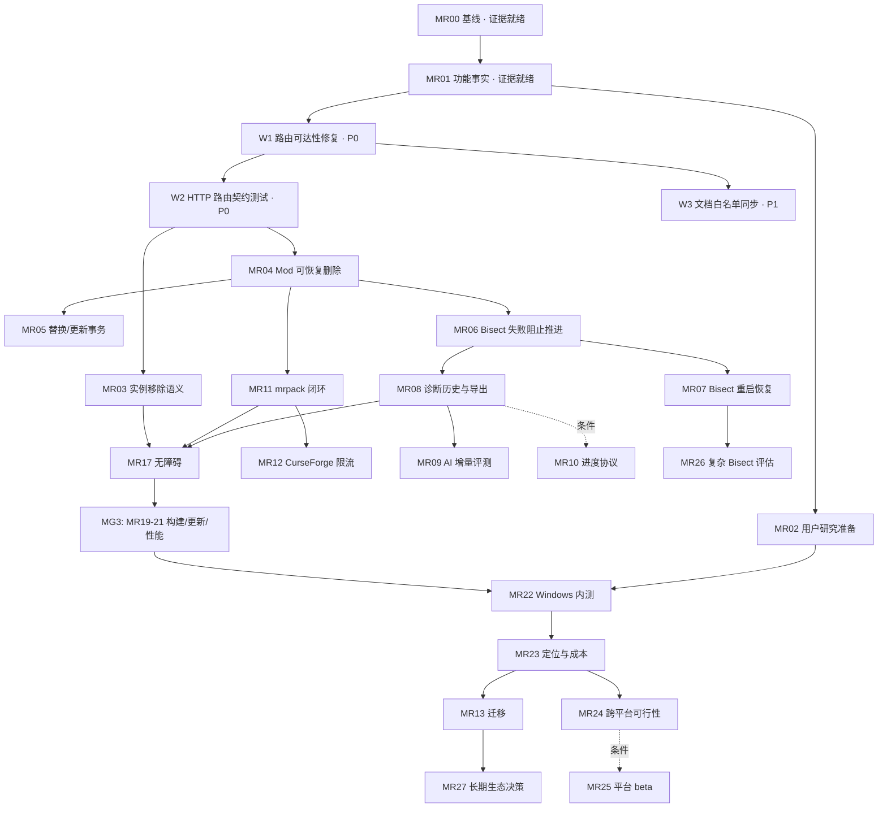

# 松光启动器：详细任务计划（2026-10-03）

> **状态：仅规划与状态整理。** 本文不宣布任何阶段放行、不修改业务代码、不启动任何执行工具、不提交不发布。执行者按任务包逐包推进，每包完成后停在"具备独立复验条件，等待独立验收"。

**本文来源：** Codex 线程 `01a0fb5e-2671-7ac1-9b5e-52a2e6bc4579`（2026-10-02）的规划产物 + 该线程随后触发的 MR00/MR01 执行证据 + 本文作者在 2026-10-03 对 `D:\松光启动器` 工作区的独立源码复核。

**与前序文档的关系：** 完整任务定义（28 个任务包的步骤、白名单、验证命令、真实场景）以 `market-research-task-workflow-2026-10-02.md` 为权威正文；本文是**可执行的任务计划与状态台账**——补齐前序文档成文后新发生的两件事：MR00/MR01 已执行，以及 P0 阻断的实测复核（范围比执行报告记录得更宽）。两者不冲突；冲突时以本文的"本轮实测"标注为准，并在执行前重新核对。

---

## 0. 一页速览

| 项 | 结论 |
|---|---|
| 规划是否完成 | ✅ 是。MR00–MR27 共 28 个任务包已定义，分 v0–v3 四层与 MG0–MG5 五道门槛 |
| 是否已执行 | 部分。仅 MR00（执行基线与源码输入）+ MR01（功能事实矩阵与调研纠偏）已执行，run-id `20261002-072004Z` |
| 该批结论 | **具备独立复验条件，等待独立验收；同时"暂不放行"任何业务任务包** |
| 唯一阻断类 | **`LocalApiService` 分派块的嵌套长度守卫导致 10 条 HTTP 路由不可达（死代码）**，且 796 个绿色测试完全无感知 |
| 建议下一批授权 | **W1 路由可达性修复 + W2 HTTP 层路由契约测试**（两者同批；W1 不改则 W2 必须 RED） |
| 另需用户裁决 | 4 项，见 §4 |
| 本文改动 | 仅新增本文一个未跟踪文件；`D:\松光启动器` 既有 1286 项工作区资产未被触碰 |

**门禁顺序被本轮实测改写：** 原计划是 MG0（MR00/MR01）通过后进入 MG1（MR03–MR07）。实际结果是 MG0 暴露出一个**比 MR03–MR07 更底层**的缺陷——bisect 与 mods 的 API 端点从未真正接通过，任何建立在它们之上的恢复、事务、UI 工作都无法端到端验证。因此 **P0 收口必须先于 MG1**。

---

## 1. 来源与基线核对

### 1.1 会话与产物

| 对象 | 精确位置 / 值 |
|---|---|
| 线程 ID | `01a0fb5e-2671-7ac1-9b5e-52a2e6bc4579` |
| 会话记录 | `C:\Users\Administrator\.codex\sessions\2026\10\02\rollout-2026-10-02T14-47-26-01a0fb5e-2671-7ac1-9b5e-52a2e6bc4579.jsonl`（152 条事件、15 次 `exec` 调用） |
| 用户原始诉求 | `"D:\市场调研"查看关于该项目的市场调研后规划一份完整详细的任务流程` |
| 最终答复时间 | `2026-10-02T07:15:26Z`（= 本地 15:15，Asia/Hong_Kong） |
| 规划正文 | `…\worktrees\ed41\松光启动器\docs\market-research-task-workflow-2026-10-02.md`（807 行 / 75,201 B） |
| 执行提示词 | `…\worktrees\ed41\松光启动器\docs\minimax-market-research-execution-prompt-2026-10-02.md`（14,060 B） |

### 1.2 目录角色（不得混用）

| 角色 | 路径 | 本轮状态 | 使用规则 |
|---|---|---|---|
| SourceRoot | `D:\松光启动器` | `main`，HEAD `f145d14eb26b0b7459a28491e764ac8c573085d3`；**脏工作区：35 个 `M` + 1251 个未跟踪，共 1286 行** | 后续实现的**事实来源**；业务任务期间默认只读，测试不得改写其中真实配置 |
| DeliveryRoot | `C:\Users\Administrator\.codex\worktrees\ed41\松光启动器` | detached HEAD，**同一 commit 但内容与 SourceRoot 不同**；含前序两份规划与全部执行证据 | 文档与证据交付根 |
| EvidenceRoot | `…\ed41\松光启动器\docs\market-execution` | 固定入口 `MR00\execution-root.json`；run-id `20261002-072004Z` | **后续证据继续写在此处**（见 §9.3） |
| ExecutionRoot | `C:\Users\Administrator\AppData\Local\Temp\pineglow-snapshot-810a28bd0d3d456c9e28201fb6fdf158` | 隔离快照，214 文件；按设计保留未清理 | 后续业务包应在**新快照**上执行，不延用同一目录做无痕覆盖 |

**关键纪律：HEAD 相同不等于内容相同。** 两个根目录 HEAD 一致，但 SourceRoot 持有 1251 个未跟踪的生产源码/测试/夹具，DeliveryRoot 没有。任何"从干净 HEAD 执行"的判断都会漏掉这些输入。

### 1.3 环境指纹（本轮实测值）

| 项 | 值 |
|---|---|
| .NET SDK | `10.0.301`（`global.json`：rollForward latestPatch / allowPrerelease false） |
| Node / npm | `v24.19.0` / `11.17.0` |
| PowerShell | `5.1.26100.9549` |
| 平台 | Windows |
| 正式 Node 测试文件 | `ui/tests` 下 **11 个** `.test.cjs`（ai-diagnose / api-contract / content-icon / launcher-behavior / launcher-content / launcher-v3 / launcher-v4 / launcher-v5 / news-behavior / news-link / skin3d-core） |
| C# 测试项目 | `dev/PineglowLauncher.Tests/Pineglow.Launcher.Tests.csproj`（xUnit） |

---

## 2. 现状事实

三类事实必须分开表述，不能互相顶替。

### 2.1 已执行且有证据（run-id `20261002-072004Z`）

| 检查 | 结果 | 证据位置 |
|---|---|---|
| 冷构建隔离快照 | 214 文件、泄漏 0、`bin`/`obj` 0、逐文件 SHA 与源一致 | `MR00\…\baseline\input-manifest.json` |
| 正式 Node 测试 | **184 通过 / 0 失败 / 0 跳过** | `MR00\…\logs\formal\01-*.json` |
| 非 RID 锁定还原 | launcher 与 tests 均 `--locked-mode` exit 0 | `logs\formal\02-*.json`、`03-*.json` |
| C# Release 全套 | **612 通过 / 0 失败 / 0 跳过** | `logs\formal\05-*.json` |
| win-x64 单文件发布 | exit 0；**45,644,552 B**；SHA256 `3B71DCC1DB72A2BC79945F611492BC366402CD455D7DA307BC06BEF33CDA7001`；三次独立快照逐字节一致 | `logs\formal\08-*.json` |
| MR01 文档包 | 6 份允许文件已更新（`README.md`、`docs/{README,features,roadmap,architecture,development-guide}.md`），补丁 60,820 B | `MR01\…\outputs\mr01-docs.patch` |
| 主工作区只读性 | 11/11 关键文件 SHA 与 manifest 一致 | `MR00\…\baseline\baseline.md` |
| 验证器缺陷修复 | `verify-source-snapshot.ps1` 两个缺陷（ASCII 写 `.cmd` 导致**假通过**、`Start-Process -Wait` 等整棵进程树导致**挂死**）已在快照副本内修复并验证 | `MR00\…\mr00-verification-defects.md` |

> 上述数字是**该 run 的当前结果**，不继承任何历史报告（首轮"252 项"、9 月 28 日"32 M + 1240 未跟踪"等旧口径作废）。

### 2.2 已知边界（明确不算通过）

| 边界 | 事实 |
|---|---|
| RID 发布锁定 | **已冻结为「接受不锁定」**（MR19，run `20261003-070000Z`）。实测：`-p:RestoreLockedMode=true` 在 RID 路径必然 NU1004；而把 lock 文件展开成含 `net10.0/win-x64` 的形态虽能让 RID 锁定还原通过，却会让**非 RID** 的 `--locked-mode` 失败（NU1004）——两者**互斥**。故 CI 取舍（非 RID 锁定 + RID 不锁定）正确，并新增不变量守卫（测试 + 两个 workflow）。 |
| `--locked-mode` 适用范围 | 仅 `dotnet restore` 支持；传给 `dotnet publish` 会 `MSB1001`。 |
| `publish` 的副作用 | 无锁定 `dotnet publish` 会**就地改写 `packages.lock.json`**（8663 → 10868 字节，新增 `Microsoft.NET.ILLink.Tasks` 与 `net10.0/win-x64` 段）。MR19 已加**不变量守卫**（`BuildLockFileTests` + `build.yml`/`release.yml` 各一步）拦住"把改写后的 lock 提交进仓库"。 |
| 白名单唯一差异 | `DownloadResumeTests.cs` 未跟踪且不在白名单，但为 **0 字节空文件**（空串哈希），SDK 默认 glob 不产生类型或测试 ⇒ 零影响，未修改白名单。 |
| 执行过程中一次越界 | 执行初期（读到提示词之前）曾把取证脚本写入 `D:\松光启动器\evidence\`，发现后已移出并清理，SourceRoot 35 `M` + 1251 未跟踪未受影响。保留记录供独立验收核对。 |

### 2.3 未验证项（不得当作已通过）

- 真实 GUI 启动 / WebView2 真实页面渲染与交互
- 真实游戏启动与主菜单到达
- 真实付费 AI 模型质量（本批明确禁止调用）
- GitHub Actions 实际运行（未推送、未建 PR）
- Linux / macOS 上的一切（含 `--locked-mode` 还原）
- 重启后 Bisect 恢复、更新失败恢复、非 Windows 真实运行
- 用户需求、安装成功率、付费意愿（无样本数据）

---

## 3. P0 阻断：路由可达性（本轮独立复核，范围比执行报告更宽）

### 3.1 缺陷机制

`dev/PineglowLauncher/Pineglow.Launcher.Services/LocalApiService.cs` 中：

```
:409   if (seg.Length == 5 && … diagnose/cancel …)   ← 已被提到块外（注释 :408 说明原因）
:415   if (seg.Length == 4 && seg[1] == "instances") {   ← 块开始
:443       if (seg.Length == 4 && action == "saves")      ← 冗余但可用
:450       if (seg.Length == 6 && action == "saves")      ← 恒假
:480       if (seg.Length == 8 && action == "saves")      ← 恒假
:511       if (seg.Length == 5 && action == "bisect")     ← 恒假
:531       if (seg.Length == 6 && action == "mods")       ← 恒假（:531 行首的 `}` 闭合的是 :526 的 giveup 分支，不是 :415 块）
:547   }                                                  ← 块结束
:789   → 落到通用 404
```

外层已要求 `seg.Length == 4`，内层再要求 `5/6/8`，条件恒为 false，永不进入 ⇒ 落到函数末尾返回 404。

**旁证：** `:408-409` 的注释显示 `diagnose/cancel` 曾因**同一类嵌套问题**被从块内提到块外；bisect / mods / saves 三条漏做。

### 3.2 不可达路由清单（10 条，已逐条定位）

| # | 路由 | 方法 | 分派行 | 保护条件 | 前端调用点 |
|---:|---|---|---:|---|---|
| 1 | `/api/instances/{id}/saves/{folder}/backup` | POST | 450 → 456 | len==6 | `ui/js/api.js:678` |
| 2 | `/api/instances/{id}/saves/{folder}/delete` | POST | 450 → 462 | len==6 | `ui/js/api.js:695` |
| 3 | `/api/instances/{id}/saves/{folder}/open` | POST | 450 → 468 | len==6 | `ui/js/api.js:699` |
| 4 | `/api/instances/{id}/saves/{folder}/backups` | GET | 450 → 474 | len==6 | `ui/js/api.js:682` |
| 5 | `/api/instances/{id}/saves/{folder}/backups/{name}/restore` | POST | 480 → 486 | len==8 | `ui/js/api.js:691` |
| 6 | `/api/instances/{id}/bisect/start` | POST | 511 → 514 | len==5 | `ui/js/api.js:752` |
| 7 | `/api/instances/{id}/bisect/test` | POST | 511 → 520 | len==5 | `ui/js/api.js:756` |
| 8 | `/api/instances/{id}/bisect/giveup` | POST | 511 → 526 | len==5 | `ui/js/api.js:760` |
| 9 | `/api/instances/{id}/mods/{file}/toggle` | POST | 531 → 535 | len==6 | `ui/js/api.js:534` |
| 10 | `/api/instances/{id}/mods/{file}/delete` | POST | 531 → 541 | len==6 | `ui/js/api.js:538` |

**对照（可用）：** `GET /api/instances/{id}/saves`（`:443`，len==4 冗余守卫）正常。

**与执行报告的关系：** 执行报告的"阻断 1"只列了 bisect + mods；**saves 的 5 条备份/恢复/删除/打开路由同样不可达，此前未被记录**。这是本文相对报告的唯一实质性扩围，须在 W1 一并修复并在 W2 一并断言。

### 3.3 真实运行证据

隔离沙盒内运行 `VerifyHost.exe --bisect-smoke --port 48130`：**exit=1**，首个 `POST /bisect/start` 即返回 404。定位方法（可复算）：预置 `portable.flag` + `data/` 使冒烟不自清理后，可见 `config.json` 与 8 个假 Mod 已生成、**无 `.disabled`** ⇒ 失败点确定在第一次 bisect 调用，而不是后续文件操作。沙盒安全性已先行审查：配置与游戏目录均落在 `<EXEC>\…\data\`，仅绑定 `127.0.0.1`。

### 3.4 为什么 796 个绿色测试完全无感知

| 断言层 | 覆盖内容 | 是否触及该缺陷 |
|---|---|---|
| `ModBisectServiceTests`（12 个 `[Fact]`） | `ModBisectService` **服务层**（`using Pineglow.Launcher.Services`） | ❌ |
| 全仓 C# 测试对 `/bisect/` 路由字符串 | — | ❌ **0 命中** |
| `AiCancelAndRedirectTests.cs:102-131, 266` | 读 `LocalApiService.cs` **源码文本找子串**（"cancel route must exist"） | ❌ 字符串在文件里，嵌套也在，静态搜索无法证伪 |
| `ui/tests/api-contract.test.cjs` | 前端契约 | ❌ 无相关断言 |
| `VerifyHost --bisect-smoke`（唯一 API 级 E2E） | API 级 | ✅ 但**从未被执行**（原 8 步脚本不含它） |
| `ui/js/api.js` 的 `_mock` 分支 | 前端降级 | ❌ 会掩盖真实 404 |

**结论：** 修复必须补**打到 HTTP 层**的断言，否则同类问题会再次静默复发。这也是 W2 与 W1 必须同批的理由。

### 3.5 影响面

- `MR06` / `MR07`（Bisect 失败处理与重启恢复）：无法端到端验证——bisect 三端点全部 404。
- `MR04` / `MR05`（Mod 可恢复删除与替换事务）：无法端到端验证——mods toggle/delete 全部 404。
- `MR03`（实例移除语义）：其 UI 与 API 路径不涉及嵌套块，但共享同一次"路由层不成立"的教训。
- 存档备份/恢复功能：**当前对用户完全不可用**（5 条路由），且没有任何测试或报告提及。

### 3.6 行号纪律

本文所有行号均为 **2026-10-03 读取 `D:\松光启动器` 工作区** 的行号。实施时必须从该任务包的 baseline 重新定位；行号漂移不得作为误改其他区域的理由。

---

## 4. 需要用户裁决的事项

以下 4 项是执行报告提出、尚未答复的门禁问题。本文只列出，不代为决定。

| # | 待裁决 | 影响 |
|---|---|---|
| D1 | **是否放行 P0 收口包（W1 + W2）** | 不放行则 MG1（MR03–MR07）无法开展端到端验证；建议放行 |
| D2 | **是否扩白名单同步文档**（W3） | `docs/api-reference.md:36-39`（mods/…、bisect/start|test|giveup）与 `:43-45`（saves backup/backups/restore）**仍把不可达路由写成可用**；`docs/engineering.md`、`docs/ai-*.md` 亦未同步本轮勘误。这些文件在 MR01 白名单外 |
| D3 | **是否接受对调研 4 条结论的下调**（Bisect 反超 Prism、唯一/领先 AI、三平台 CI=正式支持、CurseForge Key 违规） | 直接决定 MR09（AI 增量价值）与 MR14（Quilt/加载器）的优先级 |
| D4 | **下一批授权采用何种范围写法** | 模板见 §5.4；需含任务 ID、执行根、依赖验收记录、允许文件、证据根、停止点 |

---

## 5. 第一批任务卡：MG0 收口（P0，建议立即授权）

**批次定位：** 恢复路由层可达性，并建立能永久发现该类缺陷的断言。**不改任何业务 handler 的内部实现**，不改前端，不触碰存档与 Mod 文件。

**批次约束：** SourceRoot `D:\松光启动器` 全程只读；执行在**新隔离快照**上进行；证据写 `EvidenceRoot\W1-route-reachability\<run-id>\` 与 `…\W2-route-contract\<run-id>\`；完成后停止，等待独立验收，不自动进入 MG1。

### 5.1 W1：路由可达性修复

| 项 | 内容 |
|---|---|
| **目标** | 上表 10 条路由由 404 变为可达；不改变任何 handler 行为 |
| **允许文件** | `dev/PineglowLauncher/Pineglow.Launcher.Services/LocalApiService.cs` —— **仅** `:415`–`:547` 分派块及其紧邻的守卫提取语句；`dev/PineglowLauncher/VerifyHost/Program.cs`、`BisectSmoke.cs` 仅在需要调整 smoke 调用时 |
| **禁止** | 修改任何 `Handle*Async` 方法体；修改 `ModService`/`SaveService`/`ModBisectService` 实现；改动 `:415` 块外的其他路由；格式化整文件；用变量重命名掩盖 diff |
| **步骤** | ① 保留 RED 原日志：`VerifyHost.exe --bisect-smoke` exit=1，首个 `POST /bisect/start` 404。② 按 `:409` 既有做法，把 4 组 `seg.Length != 4` 的守卫**提到 `:415` 块之前**，保持精确长度匹配，并保证 `bisect`/`mods` 的守卫先于通用 `instances` 块。③ 逐条复核 `saves`(6)、`saves`(8) 守卫的提取位置不改变与 `saves`(4) 列表路由的相对顺序。④ 不动 handler 内部，GREEN。 |
| **回归要求** | `ModBisectServiceTests` 必须仍然全绿（12 项以上）；`GET /api/instances/{id}/saves` 仍返回列表；不得改变任何既有 200 响应的 body 结构 |
| **验收** | 10 条路由返回非 404 的真实施工结果（200 / 400 / 409 / 500 均可，取决于前置条件；关键是**不再因路由未命中而 404**）；`git diff` 逐行可见，仅限分派块；异常路径行为不变 |
| **证据** | `red/`（原 404 日志）、`green/`（修复后逐路由状态码矩阵）、`manifest.json`、`deliverable.md`(改动行与理由) |
| **停止点** | 停在"具备独立复验条件"；不进入 W2 之外的任务 |

### 5.2 W2：HTTP 层路由契约测试

| 项 | 内容 |
|---|---|
| **目标** | 让"路由不可达"和"新增死路由"在 CI 与本地测试中必然失败 |
| **允许文件** | 新建 `dev/PineglowLauncher.Tests/RouteReachabilityTests.cs`；扩 `dev/PineglowLauncher/VerifyHost/BisectSmoke.cs` → `--route-smoke`；`scripts/source-snapshot-inputs.txt` 追加新文件；本包测试资源 |
| **复用既有基建** | `AiCancelAndRedirectTests.cs` 已有 `TestHarness.StartAsync(AppConfig)`（`MemoryConfigStore` + `LocalApiService.Start(port)` + 真实 `HttpClient`），并已通过 `[Collection("LocalApiService")]` 串行化。新测试必须沿用同一 collection 与同一注入方式，**不得**让 `LocalApiService` 进程级静态单例被并发 `Stop()` |
| **断言口径** | ① **行为断言**：对 §3.2 的 10 条路由发起真实 HTTP，断言 `status != 404`（在合成实例与合成 Mod/存档目录下，允许 400/409 等业务状态码，只禁止"路由未命中"）。② **反死码断言**：解析 `LocalApiService.cs` 的分派块，若某 `seg.Length == N` 守卫的静态作用域内存在与之互斥的长度约束，则**测试失败**——替代现有"读源码找子串"的弱断言。③ **反向保护**：断言 `GET /api/instances/{id}/saves` 仍可达，避免修复时误删可用路由 |
| **RED 要求** | W1 未修时本测试**必须先 RED** 并保留原日志；这是本包的"有意义 RED"，不得跳过 |
| **验收** | W1 前 RED、W1 后 GREEN；测试数量可核对且 >0；`dotnet test --filter FullyQualifiedName~RouteReachabilityTests` 单独可跑通；`--route-smoke` 在 `127.0.0.1` 便携沙盒内可复跑 |
| **证据** | `red/`（W1 前失败原日志）、`green/`（W1 后通过）、`runtime/`（route-smoke 逐路由配对）、`deliverable.md` |
| **停止点** | 同上；不顺手修改其他测试文件 |

### 5.3 W3：文档白名单同步（独立子包，需 D2 裁决）

| 项 | 内容 |
|---|---|
| **目标** | 消除"文档把不可达路由写成可用"这一误导来源 |
| **允许文件** | `docs/api-reference.md`（重点 `:36-39`、`:43-45`）、`docs/engineering.md`、`docs/ai-*.md`；新增本包证据 |
| **内容** | 标注路由状态与 MR ID 归属；被 W1 修复后改回可用并注明修复 run-id；未验证项写"未验证" |
| **验收** | 文档中的每条路由可被 W2 的断言覆盖或明确标注为未验证；不残留旧断言 |
| **依赖** | W1 完成后（否则文档会写成"已修复"而实际未修） |

### 5.4 可直接复制的授权指令模板

```text
执行《松光启动器：详细任务计划（2026-10-03）》的 W1 + W2，仅执行这两个包。

执行根：使用本次新建的隔离快照（源 = D:\松光启动器，main，HEAD f145d14），
先读取 EvidenceRoot\MR00\20261002-072004Z\baseline\input-manifest.json 核对输入身份，
新快照生成新的 run-id，不覆盖 run 20261002-072004Z 的任何文件。

EvidenceRoot = C:\Users\Administrator\.codex\worktrees\ed41\松光启动器\docs\market-execution
证据目录 = EvidenceRoot\W1-route-reachability\<run-id>\ 与 EvidenceRoot\W2-route-contract\<run-id>\

允许文件：
  W1：ExecutionRoot 内 LocalApiService.cs 的 :415–:547 分派块及紧邻守卫提取；
      VerifyHost/Program.cs、BisectSmoke.cs 仅在需要时。
  W2：新建 dev/PineglowLauncher.Tests/RouteReachabilityTests.cs；
      VerifyHost/BisectSmoke.cs 扩为 --route-smoke；
      scripts/source-snapshot-inputs.txt 追加新文件。
其余路径只读。D:\松光启动器 与 D:\市场调研 全程只读。

顺序：先跑 VerifyHost --bisect-smoke 保留 RED 原日志 → W1 最小修复 → W2 先证明 RED 再 GREEN。
每步单独检查 $LASTEXITCODE；不得用分号串联后只看最后一条退出码。
回归：dotnet test … --filter FullyQualifiedName~ModBisectServiceTests 必须仍全绿；
      正式 Node 测试 11 个 .test.cjs 必须全绿。

禁止：修改任何 Handle*Async 方法体；改前端；改 git 历史或执行 reset/restore/checkout/clean/stash；
      暂存、提交、推送、建 PR、打标签、发布、部署；修改真实 %APPDATA%\MCMiniLauncher、凭据库、用户存档；
      调用真实付费模型；联系用户；分发产物；进入 MR03–MR27。

完成后停在"具备独立复验条件，等待独立验收"。若有阻断或越界，保留现场并报告精确文件与缺失条件。
```

---

## 6. 第二批任务卡：MR03–MR07（MG1 数据安全与 Bisect 恢复）

**进入条件：** W1 + W2 通过独立验收（路由层可用是这些包端到端验证的前提）；D1 已裁决；每包单独授权。

**共同纪律：** 合成目录与合成 Mod/存档；**不使用真实存档做破坏测试**；每包给出"服务层 → API → `api.js` live/mock → 页面 → 中英文 → 文档"的完整闭环；文件 SHA 前后对比；真实 GUI 与真实游戏单独留证；停在独立验收点。

| 包 | 目标 | 关键既有锚点 | 允许文件（新增件加粗） | 验收要点 |
|---|---|---|---|---|
| **MR03** | 明确实例"从列表移除"的语义与恢复入口 | `HandleDeleteInstanceAsync:1045`（零文件操作，只改 `config.Instances`） | `LocalApiService.cs` 实例查询/移除路由、`InstanceService.cs`（确需才改）、`ui/js/{api,launcher,i18n}.js`、**`InstanceRemovalTests.cs`**、**`ui/tests/instance-removal.test.cjs`** | 移除与取消均不改存档/Mod 字节；"重新添加"可恢复列表记录；运行中/正在 Bisect 的实例拒绝移除；UI 不得暗示已删除文件 |
| **MR04** | Mod 删除改为可恢复隔离 | `ModService.DeleteMod:97`、`File.Delete:107/:111`、侧车 `.mcmini.json` | `ModService.cs`、**`FileRecoveryService.cs`**、**`FileRecoveryRecord.cs`**、Mod/恢复路由、`ui/js/*.js`、`ui/css/figma.css`（仅恢复面板）、**`FileRecoveryTests.cs`**、**`file-recovery.test.cjs`** | 启用/禁用/侧车/同名冲突/跨卷失败/中断六类情境 SHA 可核对；重复恢复幂等；未知文件不被移除；真实 GUI 能删后恢复 |
| **MR05** | 替换与更新的可撤销事务 | 依赖 MR04；需先定位真实更新调用链 | `ModService.cs`、`ModContentService.cs` 安装/更新路径、MR04 恢复服务、相关 API/UI、**`ModReplacementTests.cs`** | 下载失败/哈希不符/提交中断/侧车失败/占用/重复请求均无旧版本数据损失；撤销恢复 SHA 与启用状态 |
| **MR06** | Bisect 操作失败必须阻止错误推进 | `ApplyBisectStep`/`RestoreBisectMods` 异常只写日志（`:1931-1934`、`:1952-1955`）；完成路径随后移除会话 | `ModBisectService.cs`、Bisect handlers、`ModService.cs` 启停结果、`ui/js/*.js`、`VerifyHost/Program.cs`、**`BisectFileOperationTests.cs`** | 一个文件操作失败时 API 不得仍报告"本轮就绪"；恢复失败不得把会话删除为完成；同实例并发有确定结果 |
| **MR07** | Bisect 重启恢复、依赖与世界安全 | `ModBisectService` 会话为内存 `ConcurrentDictionary:145` | `ModBisectService.cs`、**`BisectRecoveryStore.cs`**、Bisect API/UI、**`BisectRecoveryTests.cs`**、**`bisect-recovery.test.cjs`** | 中断发生在记录前/移动中/轮次提交后/恢复中各点均可恢复或逐项列出冲突；不启用用户原禁用 Mod；原存档 SHA 前后相同 |

| 包 | 粗估（有效工作日） | 优先级 | 依赖 |
|---|---|---|---|
| MR03 | 1–2 | P0 | MR01（已完成） |
| MR04 | 3–5 | P0 | MR01 |
| MR05 | 2–4 | P0 | MR04 |
| MR06 | 3–5 | P0 | MR01、MR04 |
| MR07 | 3–5 | P0 | MR06 |
| **小计** | **12–21** | | |

---

## 7. 第三至第五批与条件路线

### 7.1 第三批（MG2：诊断价值与内容生态）

| 包 | 目标 | 依赖 | 粗估 | 备注 |
|---|---|---|---|---|
| MR08 | 诊断历史、脱敏与报告导出 | MR01；动作依赖 MR04/MR06 | 3–5 | 本地模式零外发；导出不含 Key/prompt |
| MR09 | 冻结案例集验证 AI 对规则的增量 | MR08 | 3–5 | ≥30 案例；真实模型调用**需单独授权与费用确认**；未达门槛则降为实验功能 |
| MR10 | 服务端诊断进度协议 | MR08 + **确有等待体验问题** | 2–3 | **条件任务**：若 MR09 延迟可接受则记"无需实现" |
| MR11 | `.mrpack` 规范与失败恢复闭环 | MR01、MR04 | 2–4 | 导入已存在（`ImportModrinthPackAsync`），**不重写导入器** |
| MR12 | CurseForge 分发限制与限流闭环 | MR01、MR11 | 2–3 | 不作法律定性、不暴露 Key |

### 7.2 第四批（MG3：Windows 候选）

| 包 | 目标 | 依赖 | 粗估 |
|---|---|---|---|
| MR17 | 核心流程键盘、焦点与缩放 | MR03、MR08、MR11 | 3–5 |
| MR19 | 可复现构建、RID 边界与 CI | MR00 | 2–4 |
| MR20 | 自更新安全、失效与恢复 | MR19、MR04 恢复模式 | 3–5 |
| MR21 | 安装/启动与性能基线 | MR19、MR20 | 2–3 |

### 7.3 第五批（MG4：内测与定位）

| 包 | 目标 | 依赖 | 粗估 |
|---|---|---|---|
| MR02 | 用户研究材料与样本计划 | MR01 | 1–2 |
| MR22 | Windows 内测与改进闭环 | V1 全部必需任务 + **分发与联系授权** | 3–5 + 14 天观察 |
| MR23 | 产品定位、渠道与维护成本 | MR02、MR09、MR12、MR22 | 1–2 |

### 7.4 条件路线（各自独立门槛，不预设会启动）

| 包 | 门槛 | 粗估 |
|---|---|---|
| MR13 Prism/HMCL/PCL 实例迁移 | MR11 + MR22 证明用户需求 | 4–6 |
| MR14 加载器与 Quilt 投入决策 | MR02、MR22 | 1–2 |
| MR15 Legacy Fabric 支持 | MR14 通过且 MR19 就绪 | 4–6 |
| MR16 Cleanroom 支持 | 同上 | 5–8 |
| MR18 Token 统一与用户主题 | MR17 + 用户需求 | 3–5 |
| MR24 非 Windows 宿主可行性 | MR19、MR23 | 2–3 |
| MR25 单平台正式 beta | MR24 通过 + 平台范围授权 | 8–12 / 平台 |
| MR26 复杂 Bisect 与冲突可视化评估 | MR07、MR09、MR22 | 2–3（评估） |
| MR27 共享实例/扩展/手柄/移动端决策 | MR13、MR23 | 1–2（评估） |

---

## 8. 任务总表与状态台账

状态词严格使用：**未授权 / 已授权待执行 / 执行中 / 证据就绪 / 独立复验通过 / 暂不放行 / 用户已批准**。

> **证据树入口索引**（不要凭记忆找证据）：`docs/market-execution/README.md`
> —— 含四个里程碑复验包、五条复验命令、已执行包与证据位置、**剩余包的门槛审计**、以及读证据的硬规则。
>
> **本表可被脚本审计**（不要手工判断一致性）：
> `powershell -NoProfile -ExecutionPolicy Bypass -File .\scripts\audit-plan-ledger.ps1`
> 它检查四项：状态词是否合法、每个"证据就绪"的包能否定位到证据目录、是否有孤儿证据目录、引用的 run-id 是否真实存在。
> 最近一次审计：`docs/market-execution/MR00-MR27-ledger-consistency-audit/20261003-130000Z/`（exit 0）。
> **注意**：审计用前缀匹配识别"这个 run 目录属于哪个包"，因此里程碑级 run 目录需以某个已声称的包开头命名
> （如本审计目录用 `MR00-…`），或在脚本的 `claimed` 列表里显式登记（`MG1/MG2/MG3` 就是显式登记的）。

| ID | 任务 | 优先级 | 前置（权威定义） | 本轮新增前置 | 粗估 | 当前状态 |
|---|---|---|---|---|---|---|
| MR00 | 执行基线与显式源码输入 | P0 | 执行授权 | — | 2–3 | **证据就绪**（待独立验收） |
| MR01 | 功能事实矩阵与调研纠偏 | P0 | MR00 | — | 1–2 | **证据就绪**（待独立验收） |
| **W1** | **路由可达性修复** | **P0** | **MR01 证据** | **本轮新增** | **0.5–1** | **证据就绪**（证据目录 `W1-W3-route-closure/20261002-182304Z`，待独立验收） |
| **W2** | **HTTP 层路由契约测试** | **P0** | **W1** | **本轮新增** | **0.5–1** | **证据就绪**（16/16 通过；修复前 15/16 失败；证据同 `W1-W3-route-closure/20261002-182304Z`） |
| **W3** | **文档白名单同步** | **P1** | **W1 + D2 裁决** | **本轮新增** | **0.5** | **证据就绪**（api-reference.md / roadmap.md 已同步；证据同 `W1-W3-route-closure/20261002-182304Z`） |
| MR02 | 用户研究材料与样本计划 | P0 | MR01 | — | 1–2 | **证据就绪（准备包）**（run `20261003-110000Z`；提纲/任务脚本/跟进问卷/招募计划/记录模板齐备；**未招募、未联系、未访谈**，用户画像标为待验证假设） |
| MR03 | 实例移除、存档提示与恢复入口 | P0 | MR01 | W1/W2（端到端验证） | 1–2 | **证据就绪**（run `20261002-190000Z`；运行守卫收尾 run `20261003-060000Z`；**默认实例补建边界已查清**见 `MR03-default-instance-boundary/20261003-250000Z`：生产语义下会补建默认实例、而夹具不补建；另新增 A17；**并发启动守卫已补上**见 `MR03-launch-concurrency-guard/20261003-310000Z`；**并升级为原子预约**见 `MR03-atomic-launch-reservation/20261003-320000Z`；**原子性 RED 已确定性复现**见 `MR03-deterministic-atomicity-red/20261003-330000Z`）；**独立验收发现的 2 个世界备份缺陷已修**（探针原样复跑 15/15）见 `MR03-world-backup-scope-fix/20261003-500000Z` |
| MR04 | Mod 可恢复删除 | P0 | MR01 | **W1/W2（mods 路由）** | 3–5 | **证据就绪**（run `20261002-193000Z`；**边界情形已补测**见 `MR04-recovery-edge-cases/20261003-220000Z`：重解析点/占用/保留期，4 通过 + 1 跳过；**并实测出一个缺陷**：加锁文件在哈希阶段抛出，见登记表 A16；**该缺陷已于第 34 轮修复**见 `MR04-locked-file-hash-fix/20261003-230000Z`） |
| MR05 | Mod 替换/更新的事务与撤销 | P0 | MR04 | W1/W2 | 2–4 | **证据就绪**（run `20261002-201500Z`；**更新接线已补测试**见 `MR05-modcontent-update-wiring-tests/20261003-200000Z`，4 用例 RED 2 失败/GREEN 4 通过；`InstallWithDependenciesAsync` 亦已覆盖见 `MR05-dependency-install-tests/20261003-210000Z`）；**侧车版本展示已补**见 `MR05-recovery-version-display/20261003-410000Z`（并新增 A22）；**替换端点已接受版本元数据（A22 关闭）**见 `MR05-replace-version-metadata/20261003-420000Z`；**A14 生产路径端到端已验证**见 `MR05-recovery-version-display/20261003-430000Z`（并更正上轮误判）；**文件被占用/只读已实测并立不变量**见 `MR05-file-in-use/20261003-440000Z` |
| MR06 | Bisect 文件操作结果与状态一致性 | P0 | MR01、MR04 | **W1/W2（bisect 路由）** | 3–5 | **证据就绪**（run `20261002-211500Z`；**故障注入已补齐**见 `MR06-bisect-smoke-fault-injection/20261003-240000Z`：smoke 10→19 项、RED 成立、MG1 完整实跑 exit 0） |
| MR07 | Bisect 重启恢复、依赖与存档保护 | P0 | MR06 | W1/W2 | 3–5 | **证据就绪**（run `20261002-223000Z`，待独立验收）；**二分安全引导已补**见 `MR07-bisect-safety-guidance/20261003-450000Z` |
| MR08 | 诊断历史、脱敏与报告导出 | P1 | MR01；动作依赖 MR04/MR06 | — | 3–5 | **证据就绪**（run `20261002-234500Z`；含第 7 轮收尾的 UI 与分支覆盖） |
| MR09 | AI 对规则引擎的增量评测 | P1 | MR08 | — | 3–5 | **证据就绪（工具层）**（run `20261003-010000Z`；案例集 + 评分器 + 脚本已交付，**真实模型评测未做**；**案例集自洽性与代表性已校验**见 `MR09-case-set-representativeness/20261003-280000Z`） |
| MR10 | 服务端诊断进度协议 | P2 | MR08、确有进度体验问题 | — | 2–3 | **证据就绪**（**判定：无需实现**；run `20261003-120000Z`；本地诊断 p95 357ms 且界面已有诚实等待+取消、无虚假百分比；**翻转条件**与一个新发现的 311ms 瓶颈见报告） |
| MR11 | `.mrpack` 规范与失败恢复闭环 | P0 | MR01、MR04 | — | 2–4 | **证据就绪**（run `20261003-023000Z`；含第 10 轮补齐的导入取消） |
| MR12 | CurseForge 分发限制与限流闭环 | P1 | MR01、MR11 | — | 2–3 | **证据就绪**（run `20261003-043000Z`；真实限流未复现，用合成响应驱动；**出口已逐一审计并加守卫**见 `MR12-outbound-endpoint-audit/20261003-270000Z`：CF 3/3 在策略内、图标不碰 API；**新增 A18：Modrinth 侧无策略**） |
| MR13 | Prism/HMCL/PCL 实例迁移 | P1 | MR11、MR22 用户需求 | — | 4–6 | 未授权（条件） |
| MR14 | 加载器和 Quilt 投入决策 | P1 | MR02、MR22 | — | 1–2 | 未授权（条件） |
| MR15 | Legacy Fabric 支持 | P1 条件 | MR14、MR19 | — | 4–6 | 未授权（条件） |
| MR16 | Cleanroom 支持 | P1 条件 | MR14、MR19 | — | 5–8 | 未授权（条件） |
| MR17 | 核心流程无障碍与小窗口体验 | P1 | MR03、MR08、MR11 | — | 3–5 | **证据就绪（DOM/静态层）**（run `20261003-100000Z`；六处缺口已修，9 个契约用例；**真实键盘/屏幕阅读器/缩放未验证**）；**测试隔离缺陷已修**（诊断报告曾写进真实 %APPDATA%）见 `MR17-test-isolation-real-appdata/20261003-360000Z`（新增 A21）；**夹具隔离已清点并加共享守卫**见 `MR17-fixture-isolation-audit/20261003-370000Z` |
| MR18 | Token 统一与用户主题 | P2 | MR17、MR22 用户需求 | — | 3–5 | 未授权（条件） |
| MR19 | 可复现构建、RID 边界与 CI | P0 | MR00；候选前整合全部新输入 | — | 2–4 | **证据就绪**（run `20261003-070000Z`；RID 锁定按实验证据冻结为「接受不锁定」，新增不变量守卫；**托管程序集与单文件 exe 均只在同路径下逐字节可复现、跨路径不可复现；构建路径字符串被逐字嵌入产物（实测）**〔**待收窄（第 45 轮实测）**：托管程序集在 `/p:DebugType=None /p:DebugSymbols=false` 下**跨路径逐字节相同**（2 轮独立重建，SHA `F329323B…`）；含调试信息时跨路径仅差 **6 处/73 字节**且全部可归因（PDB 绝对路径 + PDB SHA256 + 3 GUID + PE 时间戳）。**结论文字未改，等你确认**；见 `MR19-dll-byte-diff-mechanism/20261003-340000Z`〕，见 `MR19-singlefile-reproducibility/20261003-150000Z`、`MR19-singlefile-pathcheck/20261003-160000Z`、`MR19-singlefile-pathlen-discriminator/20261003-170000Z`；真实 CI 与跨机器未验证；**CI 不变量已本地化**见 `MR19-ci-workflow-invariants/20261003-260000Z`） |
| MR20 | Windows 自更新的验证与恢复 | P0 | MR19、MR04 恢复模式 | — | 3–5 | **证据就绪**（run `20261003-080000Z`；备份→替换→逐字节校验→失败回滚 + UI 展示"上次替换未成功"，含 3 个真实执行用例与 `update-recovery.test.cjs`；真实安装目录替换与真实重启未做）；**旧配置不被重置已补用例**见 `MR20-config-preservation/20261003-350000Z`（并新增 A19/A20）；**主备轮转留证已测（A15 完全关闭）**见 `MR20-config-backup-rotation/20261003-480000Z`；**凭据写入契约已钉住（A19 部分推进）**见 `MR20-secret-persistence-contract/20261003-490000Z` |
| MR21 | 安装启动与性能基线 | P1 | MR19、MR20 | — | 2–3 | **证据就绪（仅测量）**（run `20261003-090000Z`；5 次观测×20 迭代，基线已冻结；定位瓶颈并量化候选修复但**未改产品代码**；真实 GUI/账号流程未测；**启动边界已实测并修掉端口硬编码缺陷**见 `MR21-startup-boundaries/20261003-290000Z`；**目录不可写亦已实测**见 `MR21-unwritable-directory/20261003-300000Z`） |
| MR22 | Windows 内测与改进闭环 | P0 | V1 全部必需任务、分发与联系授权 | — | 3–5 + 14 天 | 未授权 |
| MR23 | 产品定位、渠道与维护成本 | P1 | MR02、MR09、MR12、MR22 | — | 1–2 | 未授权 |
| MR24 | 非 Windows 宿主和平台可行性 | P2 | MR19、MR23 | — | 2–3 | 未授权（条件） |
| MR25 | 单平台正式 beta | P2 条件 | MR24 通过且获平台范围授权 | — | 8–12 / 平台 | 未授权（条件） |
| MR26 | 复杂 Bisect 与冲突可视化评估 | P2 | MR07、MR09、MR22 | — | 2–3 | 未授权（条件） |
| MR27 | 共享实例、扩展、手柄/移动端决策 | P3 | MR13、MR23 | — | 1–2 | 未授权（条件） |

> W1/W2/W3 是本文新增的**收口包**，不属于原 MR 编号体系；它们修复的是 MR00/MR01 暴露出的既有缺陷，不与任何 MR 任务的目标重叠。

### 8.1 依赖图（含新增收口包）



---

## 9. 执行通则

### 9.1 每包授权的五要素

授权必须同时包含：**任务 ID、执行根（ExecutionRoot 绝对路径）、依赖验收记录、允许文件（展开到执行根下的精确路径）、证据根与停止点**。缺一项即视为未授权。

### 9.2 统一执行顺序

- [ ] 读取 MR00 的执行根、输入 SHA、本任务允许路径；确认无额外并行写入。
- [ ] 保存任务开始前的 Git 状态、涉及文件哈希与现有差异；与快照冲突时先核对差异归属。
- [ ] 用合成隔离样本复现缺口；记录**有意义的 RED**，或明确指出基线已有正确行为（不为文档、样式微调编造 RED）。
- [ ] 最小闭环实现：服务层 → API → `api.js` 的 live/mock → 页面 → 中英文 → 文档；只碰本任务边界。
- [ ] 执行聚焦验证 + 共同回归；真实 GUI/游戏、文件恢复、取消与并发**单独留证**。
- [ ] 核对真实配置与 SourceRoot 资产未被测试改写；新增源码输入已进入白名单。
- [ ] 输出任务报告：改动白名单、测试总数/失败数、未验证项与恢复方案。
- [ ] 停在独立验收点，等待独立复验与新授权。

### 9.3 隔离、白名单与证据纪律

- SourceRoot `D:\松光启动器` 与 `D:\市场调研` 在业务任务期间**全程只读**；实现与验证在**新隔离快照**上进行。
- 证据继续写入 **ed41 的 `EvidenceRoot`**（与 run `20261002-072004Z` 同根），保持在源工作区之外；不在 `D:\松光启动器` 里新建证据目录。
- 证据目录结构：`EvidenceRoot\<任务>\<run-id>/{baseline,red,green,runtime,review}/ + manifest.json + deliverable.md`。
- 新源文件与新测试必须逐项进入 `scripts/source-snapshot-inputs.txt`；不因未跟踪而遗漏，也不把整个 `docs/` 纳入可分发包。
- 原始日志留本机；可分享索引只含脱敏摘要、命令、哈希、时间、状态。

### 9.4 禁止项（全批次）

`git reset/restore/checkout/clean/stash`、覆盖旧文件、批量删除、`git add -A`、暂存/提交/推送/PR/合并/发布/部署/打标签/镜像；改全局 `.codex` 配置、系统 PATH、网络/代理/驱动、真实账号与 Key；自动外发诊断、调用真实付费模型、联系用户、分发产物；照搬 PCL/HMCL/Prism 源码；为验证成功吞掉失败、删除失败测试、把 mock 或健康 200 当 GUI/游戏成功。

---

## 10. Gate 与停止规则

| Gate | 需要的证据 | 阻断条件 | 通过后允许的含义 |
|---|---|---|---|
| **MG0-pre（本轮新增）** | W1 + W2；路由可达性矩阵与 HTTP 层断言 | 仍有 404 死路由；断言缺失或未先 RED | 路由层可用，可开始依赖 bisect/mods/saves 端到端验证的任务 |
| MG0 基线 | MR00/MR01；执行根、输入清单、功能事实矩阵 | 源身份不明、遗漏依赖、配置混入、失败被吞 | 具备后续指定包实施条件，仍需对应授权 |
| MG1 数据安全 | MR03–MR07；真实 API/文件事务/中断恢复 | 不可恢复误删、状态与磁盘不符、恢复失败会话丢失 | 数据操作达到本范围验收条件。**当前：证据就绪**（复验包 `docs/market-execution/MG1-verification-package-20261003/`；**MR03「实例运行中不得移除」未实现**，该验收条是否接受需你判定） |
| MG2 诊断/迁移 | MR08/MR09/MR11/MR12（MR10 仅选定时必需） | 凭据泄漏、错误动作、规则降级失效、包越界、必需文件缺失却成功 | 可评价诊断增量和导入能力；AI 未达门槛则保持实验状态。**当前：证据就绪**（复验包 `docs/market-execution/MG2-verification-package-20261003/`；MR10 未实现，MR09 结论待授权） |
| MG3 Windows 候选 | MR17/MR19/MR20/MR21 + MG1/MG2 | 更新不能回退、平台身份错误、构建测试失败、关键 UI 不可用、发布信任边界未决 | 可提交内测候选供用户批准分发。**当前：证据就绪**（复验包 `docs/market-execution/MG3-verification-package-20261003/`；四类关键项未验证：真实键盘/屏幕阅读器、真实 CI、真实安装目录替换、真实 GUI），**尚不能写"可提交内测候选"** |
| MG4 内测/定位 | MR02/MR22/MR23 真实样本 | 数据事故未结、关键流程失败、无用户资料却作市场结论 | 决定 V2 任务；不自动扩大实施或公开发布 |
| MG5 增强/平台 | 选定 MR13–18 / MR24–25 的专项证据 | 版本/平台未实测、源数据被改、Windows 回退 | 仅对应功能/平台达到 beta 复验点 |
| 发布审批 | 确定输入版本、实际 CI、最终安装包与 SHA、必需真实场景、已知风险、**用户明确批准** | 任一必需证据缺口或未授权 | 才能进行已明确批准的发布动作 |

**"通过"必须分别记录**自动验证结果、独立复验结果、用户是否批准。执行者最多能写"证据就绪"。历史放行不覆盖新 diff。

**停止与恢复：**

- 真实检查失败：保留原 RED/失败日志，范围内最小修复后**新 run** 验证，不覆盖旧 run。
- 工具退出、模型耗尽、超时、step limit：任务**未完成**；依据磁盘、命令输出与剩余清单恢复，不得把进程结束写成完成。
- 路径越界、发现真实用户数据被修改、源内容来自未授权并行写入：停止写操作，保留现场，指出精确冲突与所需决定。
- 需要新 API、宿主、账号/凭据、发布策略或范围外文件：先形成可审阅差异与最小子包，再取得授权。

---

## 11. 工期

单位为**单执行者有效工作日**，含实现、自检与一次独立复验准备；不含用户等待、模型/网络不可用与多轮返工。是粗估区间，不是日期承诺。

| 批次 | 范围 | 粗估 |
|---|---|---|
| **P0 收口（本轮新增）** | W1 + W2（+W3） | **1–2.5** |
| 第一批 | MR00 + MR01 + MR02 准备 | 4–7（其中 MR00/MR01 已完成，剩 MR02 1–2） |
| 第二批 | MR03–MR07 | 12–21 |
| 第三批 | MR08/MR09 + MR11/MR12 | 10–17 |
| 第四批 | MR17 + MR19–MR21 | 10–17 |
| 第五批 | MR22/MR23 | 4–7 + **14 天观察** |
| **V1 核心合计** | — | **约 40–69 有效工作日 + 14 天观察**（含 P0 收口后约 41–71.5） |

V2 条件路线 MR13–16 / MR18 另 **17–27 工作日**（全选做时）；每个非 Windows 平台 MR24/MR25 另 **10–15 工作日**。MR10 / MR26 / MR27 仅在实际门槛触发时进入。

**算术自检：** 4–7 + 12–21 + 10–17 + 10–17 + 4–7 = 40–69 ✔（与前序文档口径一致；P0 收口的 1–2.5 为新增，未计入原 40–69）

---

## 12. 假设、非目标与风险

### 12.1 本文成立的假设

1. 行号会漂移：§3.2 与 §6 的行号仅对 2026-10-03 的 `D:\松光启动器` 工作区有效，实施前必须重新定位。
2. `D:\松光启动器` 保持脏工作区（35 `M` + 1251 未跟踪）且这些是**既有用户资产**，不是任何执行批次的成果。
3. ed41 的 `docs/market-execution/` 证据目录不被清理；`%TEMP%` 隔离快照 `pineglow-snapshot-810a28bd…` 仍在（该目录**可能被系统清理**，届时以 `input-manifest.json` 重建，不使用失效路径当证据）。
4. `packages.lock.json` 已被无锁定 `publish` 就地改写（+51 行），MR19 需按此现状处理。
5. 前序 workflow 文档的 28 个任务定义与白名单仍然有效，本文只增补状态与收口包。

### 12.2 非目标

- 不修改任何业务代码、配置或既有文档。
- 不重跑 MR00/MR01（其结果已冻结为 run `20261002-072004Z`）。
- 不代用户裁决 §4 的 4 项问题。
- 不启动任何执行工具（含 MiniMax Code、其他编程工具、Agent Teams、任务看板）。
- 不提交、不推送、不发布、不联系用户、不调用真实付费模型。

### 12.3 主要风险

| 风险 | 影响 | 缓解 |
|---|---|---|
| P0 路由缺陷影响面比报告更宽（含存档备份/恢复） | 若只修 bisect/mods，存档功能仍对用户不可用 | W1 按 §3.2 全表 10 条修复；W2 以行为断言而非字符串搜索覆盖 |
| 现有"读源码找子串"式断言 | 无法发现嵌套/作用域类缺陷，会再次复发 | W2 的反死码断言替代该做法 |
| `%TEMP%` 快照被清理 | 独立复验命令失效 | 证据以 `input-manifest.json` + 逐文件 SHA 为准；必要时重建快照并保留新 run-id |
| 无 RID 锁定 | 无法宣称完整锁定发布 | **已冻结**（MR19）：RID 形态与非 RID 锁定还原互斥，保持"非 RID 锁定 + RID 不锁定"，并由守卫防止误提交改写后的 lock 文件。若要真正锁定 RID，需放弃非 RID 校验或改用每 RID 独立 lock 文件（NuGet 目前不直接支持） |
| AI 质量无真实样本 | MR09 结论不可外推 | 未达门槛则降为实验功能，禁止"AI 优于竞品"宣传 |
| 用户研究与内测无样本 | V2 投入决策缺乏依据 | MR02 只交付材料，用户画像保持"待验证假设" |

---

## 13. 附录

### 13.1 只读基线命令

```powershell
Set-Location -LiteralPath 'D:\松光启动器'
git rev-parse --show-toplevel
git branch --show-current
git rev-parse HEAD
git status --short --untracked-files=all
git diff --stat
Get-Content -LiteralPath '.\global.json'
dotnet --list-sdks
node --version
```

### 13.2 隔离验证命令（获授权后，在 ExecutionRoot 内执行）

```powershell
# 正式 Node 测试：只使用任务根下的正式 .test.cjs，必须数量 > 0
$FormalNodeTests = @(Get-ChildItem -LiteralPath '.\ui\tests' -Filter '*.test.cjs' -File | Sort-Object Name | ForEach-Object FullName)
if ($FormalNodeTests.Count -eq 0) { throw '没有正式 Node 测试；不能报告测试成功' }
& node --test --test-reporter=spec @FormalNodeTests
if ($LASTEXITCODE -ne 0) { throw '正式 Node 测试失败' }

# 非 RID 锁定还原；逐步检查失败，不得用分号串联后只看最后一条退出码
dotnet restore .\dev\PineglowLauncher\Pineglow.Launcher.csproj --locked-mode
if ($LASTEXITCODE -ne 0) { throw '主项目锁定还原失败' }
dotnet restore .\dev\PineglowLauncher.Tests\Pineglow.Launcher.Tests.csproj --locked-mode
if ($LASTEXITCODE -ne 0) { throw '测试项目锁定还原失败' }
dotnet build .\dev\PineglowLauncher\Pineglow.Launcher.csproj -c Release --no-restore
if ($LASTEXITCODE -ne 0) { throw 'Release 构建失败' }
dotnet test .\dev\PineglowLauncher.Tests\Pineglow.Launcher.Tests.csproj -c Release --no-restore
if ($LASTEXITCODE -ne 0) { throw 'C# 完整测试失败' }

# 路由可达性（W1/W2 后）
dotnet build .\dev\PineglowLauncher\VerifyHost\VerifyHost.csproj -c Release
if ($LASTEXITCODE -ne 0) { throw 'VerifyHost 构建失败' }
& '.\dev\PineglowLauncher\VerifyHost\bin\Release\net10.0\VerifyHost.exe' --bisect-smoke --port 48130
if ($LASTEXITCODE -ne 0) { throw 'Bisect API smoke 失败（W1 未修时此处预期失败）' }

# 单文件产物（注意 publish 子目录，不是 build 输出的 apphost）
dotnet publish .\dev\PineglowLauncher\Pineglow.Launcher.csproj -c Release -r win-x64 --self-contained `
  -p:PublishSingleFile=true -p:EnableCompressionInSingleFile=true -p:DebugType=None -p:DebugSymbols=false
if ($LASTEXITCODE -ne 0) { throw 'Windows 单文件构建失败' }
```

> 注意：`--locked-mode` 是 `dotnet restore` 专属开关，传给 `dotnet publish` 会 `MSB1001`；`publish` 会就地改写 `packages.lock.json`（见 §2.2）。

### 13.3 证据索引

| 内容 | 路径 |
|---|---|
| 执行根固定入口 | `…\ed41\松光启动器\docs\market-execution\MR00\execution-root.json` |
| 输入清单（214 条 SHA） | `MR00\20261002-072004Z\baseline\input-manifest.json` |
| 基线报告 | `MR00\20261002-072004Z\baseline\baseline.md` |
| 验证器缺陷报告 | `MR00\20261002-072004Z\mr00-verification-defects.md` |
| 独立验收报告 | `MR00\20261002-072004Z\acceptance-report-2026-10-02.md` |
| MR01 改动与勘误 | `MR01\20261002-072004Z\mr01-report.md` |
| MR01 文档补丁 | `MR01\20261002-072004Z\outputs\mr01-docs.patch` |
| 路由不可达静态证明 | `MR00\20261002-072004Z\logs\unreachable-routes-proof.txt` |
| 逐步验证 JSON | `MR00\20261002-072004Z\logs\formal\*.json` |

### 13.4 来源文件指纹（沿用 workflow 附录 A，本轮未重算）

| 来源 | SHA256 |
|---|---|
| `D:\市场调研\调研净结论汇总-2026-10-02.md` | `2F9C344190F3996CC710FC3DDF417ED87955DE3DDFE1CE35FEB8373A483A1738` |
| `…\竞品调研-2026-10\松光启动器\松光启动器-竞品差距分析.md` | `22333EBE91130A85C7E4D6164EFA762164FC4193BC6FF0AEA8519E28D2ED6101` |
| `D:\市场调研\Bisect能力竞品核实-2026-10-02.md` | `E40F8A2612FF84AB4F0BAF5F0B909F21EC05FB6128B9352C25361200C8BB7827` |
| `D:\市场调研\正面断言核实-2026-10-02.md` | `483F67FDA20D13A0BD6DFF06CB9AE6B523F534802EC499E1EE3D25149FDF1069` |
| `D:\市场调研\调研缺口盘点与补充取证-2026-10-02.md` | `30E40C6A329136F01E027308BDA6DF99F7C8A9E8ABB1AD691A83123DDF98A52A` |
| win-x64 单文件产物（run 20261002-072004Z） | `3B71DCC1DB72A2BC79945F611492BC366402CD455D7DA307BC06BEF33CDA7001` |

### 13.5 术语

| 术语 | 含义 |
|---|---|
| SourceRoot / DeliveryRoot / EvidenceRoot / ExecutionRoot | 见 §1.2；四者不得混用 |
| run-id | 一次执行批次的时间戳标识（`YYYYMMDD-HHMMSSZ`），证据以此分目录，旧 run 不覆盖 |
| RED / GREEN | 先在合成样本上取到有意义的失败证据，再以最小实现使其通过 |
| 证据就绪 | 执行者完成本包并留证；**不等于**独立复验通过，更不等于用户批准 |
| KNOWN-UNLOCKED | 已知且明确记录为"未锁定"的边界，不得表述为通过 |

---

**本文结束。** 下一步唯一建议动作：审阅并批准 §5.4 的授权模板，先执行 **W1 + W2**；在它们通过独立验收前，MG1（MR03–MR07）不具备端到端验证条件。
